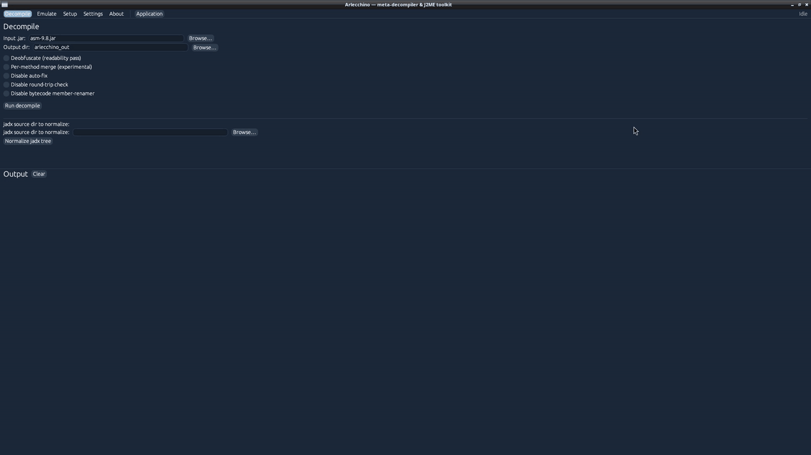
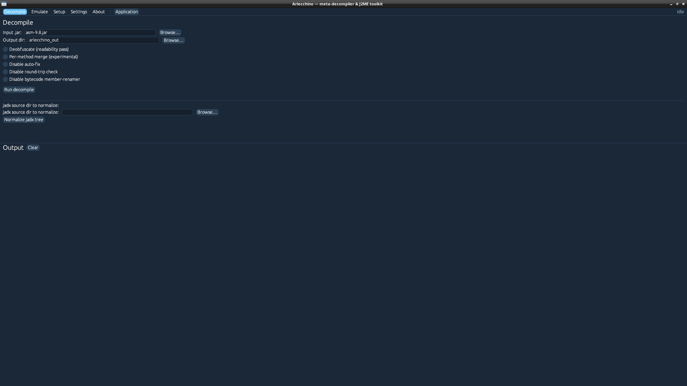
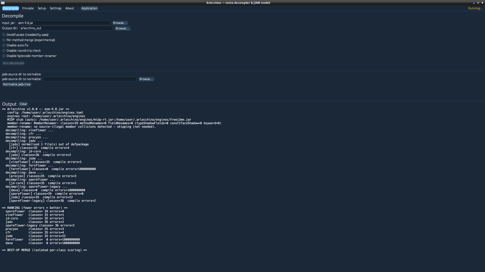
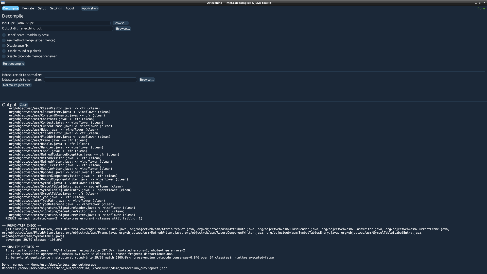

[English](README.md) | [Русский](README.ru.md) | Deutsch

[](https://github.com/wehrwolfmann/arlecchino/releases/latest) [](LICENSE)

# Arlecchino — Meta-Decompiler & J2ME-Portierungswerkzeug

Ein **Meta-Decompiler** für Java plus ein kleines **J2ME-/MIDP-Portierungswerkzeug**,
geschrieben in Rust. Er lässt mehrere Decompiler auf dieselbe `.jar` los, **normalisiert
ihre Ausgabe auf einen kanonischen Klassennamensraum**, kompiliert jede Variante und setzt
daraus einen *Best-of*-Quellbaum zusammen — für jede Klasse (optional jede Methode) behält er
die Variante mit den wenigsten Kompilierfehlern. Danach **behebt** er gängige
Decompiler-Artefakte **automatisch**, übersetzt das Ergebnis im **Round-Trip** zurück in
Bytecode, um die Abdeckung zu messen, kann für bessere Lesbarkeit **deobfuskieren** und die
ursprüngliche jar in einer mitgelieferten J2ME-Laufzeit **emulieren**.



<details>
<summary>▶ Bildschirmfotos</summary>







</details>

Sein Hauptkniff für **mit ProGuard obfuskierte** jars ist ein **kanonischer
Member-Umbenenner auf Bytecode-Ebene** (ASM): Vor dem Dekompilieren schreibt er die jar so um,
dass jedes Feld und jede Methode einen im Java-*Quelltext gültigen*, eindeutigen Namen hat —
die mit Abstand häufigste Ursache für nicht kompilierbare Decompiler-Ausgabe bei echten
obfuskierten jars.

Über demselben Kern gibt es zwei Oberflächen:

- **`arlecchino`** — das Kommandozeilenwerkzeug (siehe unten);
- **`arlecchino-gui`** — ein Desktop-Bedienfeld (Theme steam_dark), das dieselben Befehle
  mit Schaltflächen, Dateiauswahl und Live-Log bereitstellt, dazu ein Symbol im
  Systembereich und eine Aktion „zum Anwendungsmenü hinzufügen“.

> **Würdigung / Inspiration.** Die Kernidee (Vielfalt der Decompiler → Auswahl des besten
> Fragments pro Klasse/pro Methode) stammt aus *"Java Decompiler Diversity and its Application
> to Meta-decompilation"* von Harrand, Soto-Valero, Monperrus, Baudry
> ([arXiv:2005.11315](https://arxiv.org/abs/2005.11315)) und ihrem Forschungsprototyp
> *Arlecchino*. **Dies ist eine unabhängige Clean-Room-Neuimplementierung** — von ihrem Code
> wird nichts verwendet. Der wesentliche Unterschied: Das Original misst die Qualität als
> **AST-Abstand zum Originalquelltext**; dieses Werkzeug misst die Qualität als
> **Kompilierbarkeit** (Anzahl der `javac`-Fehler) und funktioniert deshalb mit
> **obfuskierten jars ohne Quelltext** — dem typischen Fall in der Praxis (z. B. beim
> Portieren alter J2ME-/MIDP-Spiele).

## Installation

### Vorgefertigte Binärdatei (empfohlen)

Eine vorgefertigte Binärdatei `arlecchino` (und `arlecchino-gui`) für Linux x86-64 liegt auf
der Seite **GitHub Releases** des Projekts — herunterladen, `chmod +x`, starten. Ein Compiler
ist nicht nötig. Zur Laufzeit wird nur ein **JDK 11+** im `PATH` benötigt
(`java`/`javac`/`javap`/`jar`); `git` braucht man nur, wenn man FreeJ2ME aus dem Quelltext baut.

### Aus dem Quelltext bauen

Benötigt eine Rust-Toolchain (Edition 2021) und zur Laufzeit ein JDK 11+ im `PATH`.

```bash
git clone https://github.com/wehrwolfmann/arlecchino.git && cd arlecchino
cargo build --release                       # -> target/release/arlecchino  (CLI)
cargo build --release --features gui,tray   # -> target/release/arlecchino-gui  (GUI + tray)
```

## Befehle

```
arlecchino setup     [--engines-root DIR] [--only vineflower,cfr,…]
                     [--freej2me-prebuilt P | --freej2me-src DIR] [--no-freej2me]
arlecchino decompile <jar> [-o OUT] [-cp DEPS] [--config C] [-j N]
                     [--midp-stub JAR | --no-midp-stub]
                     [--rename-members | --no-rename-members] [--flatten-packages]
                     [--per-method] [--deobf] [--no-autofix] [--no-roundtrip]
                     [--no-metrics]
                     [--semdiff] [--reject-semantic-drift]
arlecchino emulate   <jar> [--freej2me P] [-W 176] [-H 220] [-s 2]
arlecchino run       <jar|jad> [--midp-rt P] [--size WxH] [--rms-dir D]
                     [--no-instrument] [--trace FILE]
                     [--headless [-o OUT] [--frames N] [--period-ms N]
                                 [--boot-wait S] [--inputs SCRIPT]]
arlecchino difftest  <orig.jar> [rebuilt.jar] [--input SCRIPT] [-o OUT]
                     [--calibrate | --cross-engine [--state-tol N]]
                     [--engine freej2me|midp-rt] [--frames N] [--period-ms N]
                     [--boot-wait S] [-W 240] [-H 320]
                     [--shift-tol N] [--jaccard-margin F] [--no-baseline]
                     [--fixed-clock]
arlecchino ai-fix    [OUT] [--dry-run] [--attempts 3] [--max-classes N] [--class REL]…
                     [--provider anthropic|openai|claude-code] [--model M]
                     [--base-url URL] [--no-semantic-gate] [--no-cache] [-y]
arlecchino port-rust [OUT] [--src DIR] [--crate-dir DIR] [--crate-name N]
                     [--map FILE.map]… [--api TABLE] [--classpath CP]
                     [--jrt DIR] [--strict] [--report]
arlecchino trace-diff <ref-trace> <port-trace> [--drop-ids 3,4] [--drop-unreferenced]
arlecchino frame-diff <ref-frames> <port-frames> [--offset N] [--diff-dir DIR] [--show N]
```

`arlecchino <jar> …` ist die Kurzform von `arlecchino decompile <jar> …` (Abwärtskompatibilität).

### `setup` — Engines und Emulator besorgen

Lädt **Vineflower, CFR, Procyon, jadx** (dazu **JD-Core, Jode, Fernflower, Dava** und beide
Ausgaben von **Sporeflower**) aus ihren GitHub-Releases herunter und baut oder holt
**FreeJ2ME** nach `~/.arlecchino/engines/`. Außerdem lädt es **ASM** (`org.ow2.asm`,
BSD-3-Clause) von Maven Central nach `~/.arlecchino/engines/asm/` und kompiliert damit das
Hilfsprogramm des Bytecode-Member-Umbenenners.

Zusätzlich **erzeugt** es einen **Clean-Room-Stub der MIDP-2.0-/CLDC-1.1-API** — es
kompiliert mit `javac` öffentliche `javax.microedition.*`-Signaturen (nur ABI, leere oder
werfende Rümpfe) zu `~/.arlecchino/midp-stub.jar` —, der immer im Resolver-Klassenpfad des
Umbenenners liegt, damit Framework-Callbacks **präzise** gesperrt werden; ist `javac` nicht
verfügbar, wird auf die Offline-Sperrliste zurückgegriffen. Jedes Werkzeug behält seine
eigene Lizenz; nichts — auch nicht der MIDP-Stub — wird in diesem Repository mitgeliefert
oder in dieses Repository heruntergeladen.

#### Reproduzierbarkeit — festgelegte Engine-Versionen

Jede Engine ist **auf ein exaktes Release-Tag festgelegt** — der Download fragt
`releases/tags/<tag>` ab, niemals `releases/latest`, sodass ein neues Upstream-Release die
Hauptkennzahl nicht unbemerkt verschieben kann.

| Engine | festgelegtes Tag | Asset | ENV-Überschreibung |
|---|---|---|---|
| Vineflower | `1.12.0` | `vineflower-1.12.0.jar` | `ARLECCHINO_VINEFLOWER_VERSION` |
| CFR | `0.152` | `cfr-0.152.jar` | `ARLECCHINO_CFR_VERSION` |
| Procyon | `v0.6.0` | `procyon-decompiler-0.6.0.jar` | `ARLECCHINO_PROCYON_VERSION` |
| jadx | `v1.5.5` | `jadx-1.5.5.zip` (`bin/jadx`) | `ARLECCHINO_JADX_VERSION` |
| JD-Core | `jd-cli-1.3.0-beta-1` | `jd-cli-…-dist.zip` | `ARLECCHINO_JD_CLI_VERSION` |
| Sporeflower | `v2026.11.08.40.1` | `sporeflower-<os>-<arch>.tar.gz` (native Binärdatei) | `ARLECCHINO_SPOREFLOWER_VERSION` |
| ASM | `9.7` | Maven Central | `ARLECCHINO_ASM_VERSION` |
| FreeJ2ME-plus | `1.52` | `freej2me-v1.52.zip` (`freej2me.jar` + `freej2me-lr.jar`) | `ARLECCHINO_FREEJ2ME_PLUS_VERSION` |

[Sporeflower](https://github.com/hourianto/sporeflower) ist ein für J2ME gebauter Decompiler
(Apache-2.0). Seine aktuelle Ausgabe ist eine native Binärdatei mit eigenen
CLDC-/MIDP-/Hersteller-API-Deklarationen; `setup` entpackt den Build für das Hostsystem nach
`~/.arlecchino/engines/sporeflower/` (die `.tar.gz` läuft über das System-`tar`). Seine
frühere Java-Ausgabe, ein Vineflower-Fork, der jetzt im `legacy`-Branch des Upstreams liegt,
wird als `sporeflower-legacy.jar` von v2026.11.03.38.1 geholt, dem letzten Release, das eine
jar mitlieferte. Beide stehen in der Standardkonfiguration hinter den anderen Engines, sodass
Gleichstände weiterhin an jene gehen. Die native Ausgabe verschiebt Klassen des
Standardpakets in ein Paket `defaultpkg`, wenn die jar auch benannte Pakete hat, und benennt
Member, die sie im Quelltext für verdeckt hält, in `field_N` / `method_N` um; der Normalisierer
`sporeflower` verschiebt die Klassen zurück und stellt die Member-Namen der jar aus ihrer
Tiny-Map wieder her, damit ihre Klassen mit denen der anderen Engines zusammengeführt werden.

Jode, Fernflower, Dava (Soot) und die Sporeflower-jar sind konstruktionsbedingt festgelegt —
es sind einzelne Direktdownloads, deren Version Teil der URL ist, daher gibt es für sie keine
ENV-Überschreibung. Das neueste Release von jd-cli ist eine Beta; die Festlegung friert genau
die Version ein, mit der diese Portierung gemessen wurde, statt dem zu folgen, worauf
`releases/latest` gerade zeigt.

Ist **`GITHUB_TOKEN`** (oder `GH_TOKEN`) gesetzt, sendet `setup` es als
`Authorization: Bearer`-Header und hebt damit das anonyme Limit der GitHub-API von
60 Anfragen/h auf (optional — anonym funktioniert es auch). Ohne Netz schlagen die Downloads
kontrolliert fehl.

> Die historische Hauptkennzahl **712 → 2** (siehe unten) wurde ursprünglich mit einem
> **lokalen CFR `0.153-SNAPSHOT`** gemessen, einem Entwicklungsbuild, der jd-gui-duo
> beiliegt. Upstream gibt es kein Release `0.153`, daher legt `setup` das neueste
> *veröffentlichte* CFR-Tag fest, `0.152`. Eine lokale `arlecchino.local.toml`, die auf
> eigene jars zeigt, verwendet diese weiterhin und ist von den Downloads und Festlegungen
> durch `setup` nicht betroffen.

### `decompile` — mehrfaches Dekompilieren + Best-of-Merge

0. **Member-Umbenennung im Bytecode (AUTO).** Hat die jar im Java-*Quelltext ungültige*
   Member-Kollisionen und sind ASM und das Hilfsprogramm verfügbar, wird die jar *vor* dem
   Dekompilieren so umgeschrieben, dass jeder Member einen eindeutigen Namen hat. Die
   **umbenannte jar wird dann zur API-Referenz** für alle weiteren Schritte. Umschalten mit
   `--rename-members` / `--no-rename-members`.
1. Dekompiliert mit allen konfigurierten Engines (**parallel**, `-j`).
2. **Normalisiert Namen**, damit alle Engines in einem kanonischen Namensraum landen —
   insbesondere wird die `defpackage`-Hülle von jadx entfernt, damit jadx am Merge
   teilnimmt.
3. Bewertet jede Klasse **isoliert** gegen die ursprüngliche jar als API; das vermeidet die
   **Fehlermaskierung** von `javac` im Stapelbetrieb und reiht die Engines ehrlich.
4. **Best-of-Merge:** pro Klasse wird die Variante mit den wenigsten isolierten Fehlern
   behalten.
5. **Auto-Fix-Durchgang:** schreibt universelle Artefakte um und behält eine Korrektur nur,
   wenn sie die Fehlerzahl strikt senkt (macht nie etwas schlimmer). Sechs Durchgänge, alle
   in `src/autofix.rs`:
   * `fold_interface_static_init` — ein Konstanten-Interface, dessen `static {}`-Block die
     eigenen leeren `final`-Felder belegt, bekommt Inline-Initialisierer und *bleibt dabei
     ein Interface*, sodass jedes `implements X` gültig bleibt. Bei Gleichstand wird es der
     Ausweichlösung über eine Klasse vorgezogen, für die Konsistenz des ganzen Baums;
   * `const_interface_to_class` — die Ausweichlösung, wenn das Falten nicht greift;
   * `scratch_temp_dead_array_type` — ein synthetisches `varNNNNN`, das als ein Array-Typ
     deklariert, aber tot als ein anderer belegt wird; die tote Deklaration wird auf
     `Object` erweitert;
   * `resolve_unrepresentable_casts` — gewinnt den Cast-Typ hinter Vineflowers
     `(<unrepresentable>)` aus einem anderen Decompiler zurück, der ihn benannt hat;
   * `duplicate_imports` — Duplikate entfernen;
   * `illegal_static_local` — entfernt `static` von einer lokalen Deklaration.

   Jeder Durchgang durchsucht eine **längenerhaltende maskierte Sicht** des Quelltexts, in
   der String-Literale, Zeichenliterale und Kommentare ausgeblendet sind, sodass ein `{`,
   `}`, `;` oder Schlüsselwort darin weder eine Blockgrenze verschieben noch eine falsche
   Änderung auslösen kann (`tests/autofix_mask.rs`).
6. **Round-Trip-Prüfung:** kompiliert den Merge erneut zu `.class` und meldet, wie viele der
   ursprünglichen Klassen abgedeckt sind, dazu einen groben Vergleich der Member-Anzahl mit
   dem ursprünglichen Bytecode.
7. **Qualitätskennzahlen:** syntaktische Korrektheit, Übereinstimmung zwischen den
   Decompilern und eine strukturelle Verhaltensprüfung. Diese Stufe kompiliert und vergleicht
   jede Klasse über Kreuz und kostet bei einer großen jar Minuten — `--no-metrics`
   überspringt sie; alles, was der Merge selbst meldet, wird schon vorher ausgegeben.
8. Schreibt `merged/`, `report.md`, `report.json` und Bäume pro Engine unter `-o`.

`--deobf` ist **partiell** und heuristisch: Es versieht die Klassen in `merged/` mit ihrer
wahrscheinlichen MIDP-Rolle und erzeugt daneben einen separaten `jadx --deobf`-Baum. Namen
stellt es nicht wieder her.

`--per-method` ist **experimentell** und standardmäßig aus. Beim Referenzspiel lösen die
Auto-Fixes über Engines hinweg die Restfehler zuverlässiger als das Einspleißen ganzer
Methoden — die Engines sind sich bei Namen lokaler Variablen und Felder uneinig, daher
gelingt ein Spleiß mit strikter Verbesserung selten. Außerdem enthält es eine bewusste,
gemessene Abweichung von der Referenzimplementierung: Methoden werden in Schlüsselreihenfolge
statt in Quelltextreihenfolge besucht; bei dieser jar findet das zwei Spleiße und erreicht
eine isolierte Summe von 3, während die Quelltextreihenfolge einen findet und bei 4 stehen
bleibt.

### `--semdiff` — semantischer Round-Trip

Die einfache Round-Trip-Prüfung belegt nur die **Abdeckung** (jede ursprüngliche Klasse hat
eine kompilierte ergeben) und **grobe Zählwerte** (Member und Methoden laut `javap -p`). Ein
Auto-Fix kann die *Semantik* ändern, ohne eines davon zu berühren — vor allem die drei, die
Konstrukte direkt neben dem Verhalten umschreiben: Die Erweiterung des toten Arrays kann
`new int[]` zu `new char[]` machen, das Falten des statischen Blocks kodiert `<clinit>` neu,
und Interface→Klasse ändert Aufrufstellen von `invokeinterface` zu `invokevirtual`.

`decompile --semdiff` disassembliert die ursprüngliche Klasse (aus der umbenannten jar — der
kanonischen API, die die ganze Pipeline ohnehin nutzt) und die neu kompilierte, Methode für
Methode, normalisiert die Unterschiede, die ein Round-Trip aus Dekompilieren und
Neukompilieren berechtigterweise erzeugt, und **markiert** Methoden, deren normalisierte
Menge symbolischer Referenzen sich inhaltlich unterscheidet. An den Merge-Regeln ändert es
nie etwas.

**Warum eine Menge symbolischer Referenzen und nicht der Opcode-Strom?** Ein strikter
`javap -c`-Vergleich ist hoffnungslos verrauscht: `javac` kodiert dekompilierten Quelltext
mit anderer Sprungpolarität (`if_icmpge` ↔ `if_icmplt; return`), anderen Slot-Nummern für
lokale Variablen, anderen `dup`- / `x++`-Idiomen und weggelassenen Neuladevorgängen neu —
nichts davon ändert das Verhalten. Die Kalibrierung eines zeilenweisen Vergleichs am als gut
bekannten Referenz-Merge ergab Hunderte falscher Unterschiede.

Das Signal, das stabil **und** frei von Fehlalarmen ist, verwendet diese acht Regeln:

| # | Regel | Grund |
|---|---|---|
| N1 | Methode mit Methode vergleichen, Schlüssel ist eine Signatur ohne Zugriffsmodifikatoren | eine Methode, die nur auf einer Seite existiert, wird markiert |
| N2 | Feld-/Methodenreferenzen als `(kind, name, descriptor)` behalten, **die Besitzerklasse verwerfen** | `javac` löst einen Member erneut zu dem Supertyp auf, der ihn *deklariert* (`Field aa.H:I` vs. `Field j.H:I`) — derselbe Member, ein kosmetischer Unterschied |
| N3 | die **Art** des Aufrufs unterscheiden (`Method` vs. `InterfaceMethod`), Besitzer weiterhin verworfen | so wird Interface→Klasse weiterhin erkannt, die erneute Auflösung über ein Interface aber nicht fälschlich markiert |
| N4 | `StringBuffer` ↔ `StringBuilder` vereinheitlichen | Decompiler erzeugen für `+` das moderne `StringBuilder`, wo der obfuskierte Bytecode `StringBuffer` verwendete |
| N5 | primitive Array-Erzeugung `newarray <type>` erfassen | genau das, was die Erweiterung des toten Arrays ändern kann |
| N6 | `checkcast` / `instanceof` **ausschließen** | Decompiler fügen überflüssige Downcasts ein, die das Original statisch verifiziert hatte |
| N7 | das synthetische `getClass():Class` **ausschließen** | das Nullprüfungs-Idiom von `javac`, das dekompilierter Quelltext nicht reproduziert |
| N8 | umbenannte Member über `mapping.txt` abgleichen (umgekehrte Abbildung `newName → oldName`) | ein vom Umbenenner umbenannter Member darf nicht wie eine semantische Änderung aussehen |

**Kalibrierung.** Mit N1–N8 ergibt der als gut bekannte Referenz-Merge 712→2 **null**
Fehlmarkierungen über alle **31** sauber neu kompilierten Klassen — einschließlich der drei,
die der Merge automatisch korrigiert hat (ein totes Hilfsarray, ein gefaltetes
Konstanten-Interface, ein aufgelöster Cast), von denen keine die Semantik ändert.
Synthetische Abweichungen Interface→Klasse und beim Array-Elementtyp *werden* markiert
(`tests/semdiff_javap.rs`).

Alles degradiert sanft: Ohne `javap` meldet das Modul `available = false` und tut nichts;
eine Klasse, die sich nicht neu kompilieren ließ, wird übersprungen und gemeldet, nicht
markiert.

`decompile --reject-semantic-drift` impliziert `--semdiff` und macht aus dem Bericht eine
Entscheidung: Jede Klasse, die der Merge automatisch korrigiert hat, wird erneut geprüft, und
ein Auto-Fix, dessen neu kompilierter Bytecode vom Original abweicht, wird zugunsten der
besten nicht automatisch korrigierten Variante **verworfen** — aber nur, wenn das Zurücksetzen
die isolierte Fehlerzahl dieser Klasse nicht erhöht. Damit kann es die bestehende Regel
„eine Korrektur nur annehmen, wenn sie die Fehlerzahl strikt senkt“ nur verschärfen, nie
lockern. Zurückgesetzte Klassen stehen in `report.json` unter `semantic_drift_reverts`.

### `emulate` — die jar in FreeJ2ME ausführen

Dünne Hülle um die AWT-Oberfläche von FreeJ2ME:
`java -jar freej2me.jar <midlet.jar> W H scale`.

`setup` installiert außerdem **`freej2me-lr.jar`** — die libretro-(Pipe-)Oberfläche von
FreeJ2ME-plus. `src/diffrun.rs` steuert sie über einfaches stdin/stdout für die
**Bildaufnahme ohne Anzeige**: kein Fenster, kein X-Server, kein SDL, kein nativer Code. Das
ist die Grundlage des Prüfstands für Verhaltensvergleiche; das Protokoll und seine Fallstricke
sind in [`docs/headless-capture-protocol.md`](docs/headless-capture-protocol.md) dokumentiert.

**FreeJ2ME-plus steht unter GPLv3** und wird immer nur als separater Prozess ausgeführt —
nie gelinkt, nie mitgeliefert.

### `run` — das MIDlet in midp-rt ausführen

Startet das MIDlet in **midp-rt** (einem LGPL-Fork von MicroEmulator) als **separaten
Prozess** — die LGPL-Grenze ist die Prozessgrenze; hier wird nichts unter LGPL gelinkt.
`MIDlet-1` wird aus dem Manifest/der `.jad` gelesen, sodass das MIDlet automatisch startet,
statt im Starter der Laufzeit zu warten. `--headless` nimmt PNG-Bilder + `index.json` auf,
statt ein Fenster zu öffnen.

**Woher midp-rt kommt.** Seine Quelltexte liegen in diesem Repository unter `midp-rt/`
(git subtree, LGPL 2.1 — siehe `midp-rt/COPYING-LGPL-2.1`), die gebaute jar aber nicht:
`midp-rt/build/` wird von git ignoriert. Einmal bauen mit
`arlecchino setup --only midp-rt` (das `midp-rt/build.sh` für dich ausführt) oder von Hand
mit `cd midp-rt && ./build.sh`. Die jar wird dann in dieser Reihenfolge gesucht:

1. `--midp-rt PATH`;
2. `$ARLECCHINO_MIDP_RT`;
3. `<engines root>/midp-rt.jar` (standardmäßig `~/.arlecchino/engines`);
4. `midp-rt.jar` neben der Binärdatei `arlecchino`;
5. `build/midp-rt.jar` in einem beliebigen Quelltext-Checkout des Forks — `$ARLECCHINO_MIDP_RT_SRC`,
   `<engines root>/midp-rt`, ein Verzeichnis `midp-rt/` neben der Binärdatei oder in einem
   ihrer übergeordneten Verzeichnisse (so findet ein Build in `target/release/` den Subtree
   im Baum) oder `~/Projects/arlecchino-midp-rt`.

Trifft nichts davon zu, gibt der Befehl jeden geprüften Pfad aus und wie man das Problem
behebt.

`arlecchino difftest --engine midp-rt` führt den Verhaltensvergleich über midp-rt statt über
FreeJ2ME-plus aus — eine zweite, unabhängige Referenz-Engine. Auf ein und derselben Maschine
ist ihre Darstellung vollständig deterministisch: Beim Referenzspiel ergaben Original und
Neubau **Jaccard 1,00 und 100 % Bild für Bild sowohl in der Basislinie als auch im
Kreuzvergleich**, wo FreeJ2ME-plus 0,86 / 97 % liefert. Dieser Determinismus erstreckt sich
derzeit **nicht** auf `--fixed-clock` mit dieser Engine — die gemessene Grenze beschreibt
[`docs/determinism-fixed-clock.md`](docs/determinism-fixed-clock.md).

### `difftest` — Verhaltensvergleich (verhält sich die neu gebaute jar noch genauso?)

Führt beide jars ohne Anzeige mit demselben Eingabeskript aus und vergleicht die **Struktur
der Bildschirmzustände** — die Menge der Bild-Hashes, die Reihenfolge ihres ersten Auftretens
und die Bildindizes des ersten Auftretens (mit einer Verschiebungstoleranz) — dazu
RMS-Nebenwirkungen und Absturzsignale aus dem stderr des Emulators. Der *Inhalt* der Bilder
ist deterministisch, ihr *Timing* nicht; daher wird zuerst eine Rausch-Basislinie gemessen
(dieselbe jar zweimal ausgeführt), und das Urteil fällt nur bei Signalen negativ aus, die
stärker als dieses Rauschen sind.

* `--calibrate` — nur die Basislinie (eine jar, zweimal).
* `--cross-engine` — dieselbe jar in FreeJ2ME-plus **und** midp-rt, weich verglichen (nur
  die Struktur; Pixel stimmen zwischen Engines nie überein, daher ist der Pixel-Jaccard nur
  informativ).
* `--fixed-clock` — die jar(s) vorher per ASM mit einer virtuellen Uhr und einem RNG mit
  festem Seed instrumentieren, damit Wiederholungen bildgenau identisch werden.

#### Format des Eingabeskripts

`run --inputs` und `difftest --input` nehmen ein JSON-Array von Ereignissen entgegen:

```json
[
  {"t_ms": 4500, "key": "FIRE",  "action": "tap"},
  {"t_ms": 6000, "key": "DOWN",  "action": "press"},
  {"t_ms": 6300, "key": "DOWN",  "action": "release"},
  {"t_ms": 7500, "key": "NUM5",  "action": "tap"}
]
```

* `t_ms` — Millisekunden ab dem **ersten aufgenommenen Bild** (also ab dem Ende von
  `--boot-wait`), nicht ab dem JVM-Start. Das Array muss nicht sortiert sein. Die
  Wiedergabe richtet sich nach bestem Bemühen nach der Wanduhr: Ein Ereignis wird vor der
  ersten Bildanforderung mit `now >= t_ms` eingespeist, ist also nicht bildgenau —
  `--fixed-clock` bildet `t_ms` stattdessen auf einen Bildindex ab und macht die eigene
  Logik des MIDlets deterministisch.
* `key` — eines von `UP DOWN LEFT RIGHT`, `NUM0`…`NUM9`, `STAR`, `POUND`,
  `FIRE` (= `SOFT3`, die mittlere Softkey-Taste), `SOFT_LEFT`, `SOFT_RIGHT`, `CLR` — oder ein
  roher ganzzahliger Joypad-Index der libretro-Oberfläche.
* `action` — `press`, `release` oder `tap` (ein Drücken, unmittelbar gefolgt von einem
  Loslassen). Standard ist `press`. Ein unbekannter Tastenname ist ein harter Fehler, kein
  verworfenes Ereignis.

Beide Engines nehmen dasselbe Format entgegen, aber unter `--engine midp-rt` unterscheiden
sich zwei Dinge, weil die Wiedergabe von der Laufzeit selbst übernommen wird und nicht von
einem libretro-Joypad:

* `FIRE` / `SELECT` / `SOFT3` werden auf die Taste **SELECT** des MicroEmulator-Geräts
  abgebildet (die mittlere Taste, Spielaktion FIRE), und `CLR` auf **DELETE**;
* eine **rohe Ganzzahl** in `key` bedeutet einen **MIDP-keyCode** (z. B. `53` = `NUM5`),
  *nicht* einen libretro-Joypad-Index. Ein Skript mit fest kodierten Joypad-Indizes wird
  daher beim Lauf über midp-rt stillschweigend anders interpretiert — in Skripten, die für
  beide Engines gedacht sind, die symbolischen Namen verwenden.

### `ai-fix` — optionale modellgestützte Reparatur der Reste

**Standardmäßig aus; läuft nur auf Aufruf und sendet Code an ein Modell.** Es arbeitet auf
der Ausgabe eines vorherigen `decompile`-Laufs (`OUT`, standardmäßig `arlecchino_out`) und
berührt nur die Klassen, die nach Best-of und Autofix noch nicht kompilieren. Für jede davon
bekommt das Modell die javac-Fehler, die zusammengeführte Variante, die *abweichenden
Bereiche* der Varianten jeder anderen Engine, die Member und fehlschlagenden Methoden des
ursprünglichen Bytecodes sowie die Signaturen der Klassen aus der jar, auf die die Klasse
verweist.

Eine Antwort wird nur angenommen, wenn alle folgenden Bedingungen erfüllt sind — andernfalls
wird sie abgelehnt und die neuen Fehler (oder die abweichenden Methoden) werden
zurückgemeldet, bis zu `--attempts`-mal:

1. die Klasse kompiliert isoliert gegen die ursprüngliche jar mit null Fehlern;
2. sie deklariert dasselbe Paket und denselben Top-Level-Typ;
3. ist `javap` verfügbar, findet die semantische Round-Trip-Schranke (die Normalisierung von
   `--semdiff`) keine Methode, deren Menge von Aufruf-, Feld- und `new`-Referenzen vom
   ursprünglichen Bytecode abweicht — so lässt sich eine Klasse nicht durch Löschen von Code
   „reparieren“ (`--no-semantic-gate` schaltet das ab);
4. nach allen Ersetzungen hat der gesamte zusammengeführte Baum nicht mehr Fehler als vorher;
   andernfalls werden angenommene Klassen zurückgesetzt.

Alles landet in `OUT/ai_fix/`: `report.md` und `summary.json` (fehlschlagende Klassen,
isolierte und Gesamtbaum-Fehler vorher → nachher), `journal.jsonl` (jeder Versuch und warum
er angenommen oder abgelehnt wurde), `attempts/` (jeder Kandidat), `before/` (der ersetzte
Text), `prompts/` und der Antwort-`cache/`. `--dry-run` schreibt die Prompts und sendet
nichts.

Der Anbieter ist standardmäßig die Anthropic Messages API (`ANTHROPIC_API_KEY`) oder ein
beliebiger OpenAI-kompatibler Endpunkt mit `--provider openai --base-url …` — z. B. ein
lokaler Server, sodass der Code die Maschine nie verlässt. Vor dem Senden an einen entfernten
Endpunkt warnt der Befehl und bittet um Bestätigung (`-y` überspringt die Frage).

Wenn du Claude Code installiert hast und angemeldet bist, kann es statt eines API-Schlüssels
verwendet werden: `--provider claude-code` (oder `provider = "claude-code"` in der Tabelle
`[ai]` oder `ARLECCHINO_AI_PROVIDER=claude-code`). Jede Anfrage führt dann
`claude -p --output-format json` aus, mit dem Prompt auf stdin, allen Werkzeugen deaktiviert
und ohne MCP-Server, im abgesicherten Modus (deine eigene CLAUDE.md, Hooks und Plugins werden
nicht geladen) und in einem leeren Arbeitsverzeichnis, eine Anfrage nach der anderen. Dabei
werden die Nutzungslimits deines Claude-Code-Abonnements verbraucht, die du dir mit deinen
anderen Claude-Code-Sitzungen teilst. Arlecchino startet nur das Programm — es liest nie die
Einstellungen oder Zugangsdaten von Claude Code. Das Programm ist `claude` aus dem `PATH`
oder `ARLECCHINO_CLAUDE_BIN` / `claude_bin = "…"`; `--model` wird durchgereicht (sonst gilt
die Voreinstellung der CLI), `timeout_secs` (Standard 600) begrenzt jeden Aufruf, und
`claude_args = ["…"]` hängt zusätzliche CLI-Argumente an. Der Antwort-Cache und `--dry-run`
verhalten sich wie bei den anderen Anbietern. Dasselbe gilt für `ai-rename` und
`ai-annotate`.

### `port-rust` — mechanische Übersetzung nach Rust (experimentell)

Übersetzt den zusammengeführten Baum eines vorherigen `decompile`-Laufs (`OUT/merged` oder
mit `--src` einen beliebigen Java-Baum) in ein Cargo-Crate (standardmäßig `OUT/rust`) auf
Basis des Laufzeit-Crates `jrt` (`jrt/` in diesem Repository). Zuerst attribuiert `javac`
den Baum (`assets/JavacAstDump.java`, einmal nach `~/.arlecchino/helpers/port-rust`
kompiliert), sodass der Generator den Typ jedes Ausdrucks und das Ziel jedes Aufrufs kennt:
Java-Ganzzahlsemantik, implizite Erweiterung, `switch` mit Fall-through, Sprünge mit Labels
und `try`/`catch` werden exakt übertragen. Plattformaufrufe werden über eine Tabelle
gebunden (`assets/port-rust-api.tsv`, eine Zeile pro MIDP-/CLDC-Member; `--api` für eine
andere).

Die Namen bleiben erhalten, in Rust-Schreibweise: Klasse `GameEngine` →
`game_engine::GameEngine`, `frameCounter` → `frame_counter`, statisches `maxLives` →
`MAX_LIVES`; Rust-Schlüsselwörter werden zu Raw Identifiers. `--map` wendet beim Generieren
eine Namensabbildung im `.map`-Format von Sporeflower an (Klassen-, Feld-, Methoden- und
Parameternamen mit `/* was … */`-Markierungen).

Was nicht übersetzt wird (ein API-Aufruf, der in der Tabelle fehlt, ein Konstrukt, das der
Generator noch nicht beherrscht), wird zu einer typisierten `jrt::todo_ai!`-Markierung,
sodass das Crate trotzdem baut; die Markierungen stehen in `residue.json` und werden in
`report.txt` gezählt (`--report` gibt ihn aus, `--strict` beendet mit Status 1, wenn es
welche gibt). Das Crate hat eine Binärdatei `trace`, die das Spiel ohne Anzeige ausführt und
eine Aufrufspur im Format von midp-rt schreibt, für einen zeilenweisen Vergleich mit der
ursprünglichen jar unter midp-rt (`arlecchino trace-diff`):

```sh
trace <res-dir> <trace-out> 240 320 <frames> [--ticks] [--inputs ticks.json] [--frames-dir DIR]
```

`--inputs` (oder `--ticks`) führt es so aus, wie `Headless --ticks N --inputs F` von midp-rt
die jar ausführt: dasselbe Tick-Szenario, Ereignisse werden in ihrem Tick zugestellt, bevor
dessen Bild gezeichnet wird, und der Lauf endet nach N Ticks. `--frames-dir` zeichnet jedes
Bild mit dem Software-Renderer `jrt::raster` und schreibt `frame_NNNN.png`, wobei Bild i der
Bildschirm nach Tick i ist, so wie es `--frames-dir` von midp-rt tut; `arlecchino frame-diff`
vergleicht dann die beiden Verzeichnisse Pixel für Pixel (identische Bilder und Pixel in
Prozent, ein Rahmen pro abweichendem Bild, `--diff-dir` für Bilder mit den abweichenden
Pixeln in Rot).

Der Renderer folgt midp-rt, nicht einem idealisierten MIDP: `fillRect`, Rechtecke und gerade
Linien, `drawImage`/`drawRegion` (alle Transformationen, Anker einschließlich der
`drawRegion`-Arithmetik von midp-rt), Clipping, Verschiebung und Java2D-Alpha-Blending sind
exakt; schräge Linien und Dreiecke sind angenähert; Bögen, abgerundete Rechtecke und Text
werden nicht gezeichnet (die Binärdatei `trace` gibt aus, wie viele solcher Aufrufe sie
übersprungen hat). Der Bildschirm beginnt schwarz; ein veränderbares Bild beginnt
transparent, hält seine Farben vormultipliziert und wird ohne seinen Alphakanal gezeichnet,
wie unter midp-rt. Die `Font`-Metriken sind eine unter midp-rt gemessene Tabelle
(AWT-Schriften, sie gelten also für die Maschine, auf der sie gemessen wurden).

## GUI

`arlecchino-gui` ist ein kleines Desktop-Bedienfeld (gebaut mit eframe/egui, Theme
steam_dark). Es führt dieselben Befehle `decompile` / `emulate` / `setup` als Unterprozesse
aus, leitet deren Ausgabe in einen Log-Bereich und ruft den Normalisierer für jadx-Bäume
direkt auf. Außerdem bietet es:

- **Zum Anwendungsmenü hinzufügen** — installiert einen freedesktop-`.desktop`-Starter und
  ein Symbol in deine XDG-Benutzerverzeichnisse (ohne root).
- **Deinstallieren…** — entfernt nach einem Bestätigungsdialog die installierten
  Binärdateien, den Starter und das Symbol.
- ein **Symbol im Systembereich** (KDE/StatusNotifierItem) mit *Panel öffnen* / *Beenden*.

### Anwendungssymbol

Das Anwendungssymbol ist eine goldene venezianische Halbmaske mit dem Harlekin-Rautenmuster
auf der Stirn — ein eigenes Kunstwerk nach gemeinfreien Motiven der *Commedia dell'arte*,
ausgeliefert als zwei in sich geschlossene SVGs, die in die GUI-Binärdatei eingebettet sind:

- `assets/icon.svg` — die Vorlage, installiert nach
  `~/.local/share/icons/hicolor/scalable/apps/arlecchino.svg`;
- `assets/icon-small.svg` — dasselbe Motiv ohne die Gravur, installiert nach
  `hicolor/16x16` und `hicolor/24x24`, weil unterhalb von ~32 px ein ganzes Ornament unter
  ein Pixel fällt und nur die Silhouette verschmiert.

Für ein anderes Symbol diese Dateien ersetzen und neu bauen oder die installierten Kopien an
Ort und Stelle ersetzen. Sie sollten in sich geschlossen bleiben (keine Rasterdaten, keine
Schriften, keine externen Verweise) — der Starter schreibt die Datei unverändert.

## Sprache (EN / RU / DE)

Alle für Benutzer sichtbaren Texte (GUI sowie Rahmentexte und Fehler der CLI) gibt es auf
**Englisch**, **Russisch** und **Deutsch**. Reihenfolge der Auswahl:

1. `ARLECCHINO_LANG=en|ru|de` — Überschreibung (so gibt auch die GUI ihre Sprache an die
   CLI-Unterprozesse weiter, die sie startet);
2. die gespeicherte Einstellung in `~/.config/arlecchino/settings.toml`
   (`language = "system" | "en" | "ru" | "de"`), geschrieben über das GUI-Menü
   **Einstellungen -> Sprache** — der Standardwert `system` behält das unten beschriebene
   Verhalten nach Locale bei;
3. die System-Locale (`LC_ALL` → `LC_MESSAGES` → `LANG`; `ru*` → Russisch, `de*` →
   Deutsch, alles andere → Englisch).

Ein Sprachwechsel in der GUI wirkt sofort — ohne Neustart — und bleibt für den nächsten
Start erhalten. Technische Ausgaben (Inhalt von report.json / report.md, Fortschritts- und
Merge-Logs, Dateipfade, Flag-Namen) bleiben stabil und unübersetzt.

## Ehrliche Fehlerzahlen

`javac` arbeitet **pro Aufruf nach dem Alles-oder-nichts-Prinzip**: Ein einziger früher
Strukturfehler bricht die Attribution der *anderen* Dateien ab und **maskiert** deren echte
Fehler. Dieses Werkzeug **kompiliert stattdessen jede Klasse isoliert** gegen die
ursprüngliche jar (die die kanonische API jeder Nachbarklasse liefert) und summiert die
Fehler pro Klasse — eine ehrliche, nicht maskierbare Kennzahl. Außerdem fügt es automatisch
einen **MIDP-Stub** zum Klassenpfad hinzu, damit sich `javax.microedition.*` auflösen lässt:
zuerst `midp-rt.jar`, wenn es installiert ist (seine Signaturen folgen der Spezifikation),
dann die jar von FreeJ2ME (Hersteller-APIs und alles, was midp-rt fehlt). FreeJ2ME allein
lässt einige geprüfte Ausnahmen weg — z. B. `Player.stop()` ohne `throws MediaException` —,
wodurch ein originalgetreues `catch` zum Kompilierfehler wird. Überschreiben mit `-cp`,
`--midp-stub` (allein verwendet) oder `--no-midp-stub`.

Eine naive Kompilierung des ganzen Baums einer stark obfuskierten jar kann daher eine
trügerisch kleine Zahl melden. Ein früher Prototyp dieses Werkzeugs meldete beim
Referenzspiel „1 Fehler“ — das war ein Maskierungsartefakt von `javac`, bei dem ein
Interface-Fehler rund siebenhundert echte verdeckte. Die Zahlen unten sind die ehrlichen,
unmaskierten isolierten Zählwerte, und an ihnen gemessen schlägt der Merge tatsächlich jede
einzelne Engine.

## Beispiel — gemessen an einer obfuskierten J2ME-Spiel-jar

⚠️ **Bedingungen.** Diese Zahlen wurden im Juni 2026 an `Allods_1_2_240x320.jar` gemessen,
mit einer **lokalen Konfiguration aus vier Engines**, deren CFR der unveröffentlichte
Entwicklungsbuild `0.153-SNAPSHOT` war (siehe den Hinweis unter `setup`). Sie sind das
Hauptergebnis des Projekts und werden hier als solches zitiert. Sie sind **nicht** die
aktive Prüfschranke — das ist `regress/expected.txt`, später mit sechs festgelegten Engines
gemessen und jar für jar mit der Referenzimplementierung abgeglichen; für dieselbe jar meldet
es andere (ebenso gültige) Zahlen. Die beiden widersprechen sich nicht; siehe
[`docs/history-and-decisions.md`](docs/history-and-decisions.md).

Pro Engine, **Member-Umbenenner AUS**, isolierte Fehler (weniger ist besser):

| Engine | Klassen | isolierte Fehler |
|---|---|---|
| cfr | 30 | 978 |
| vineflower | 30 | 1053 |
| jadx | 32 | 1066 |
| procyon | 30 | 1183 |

Mit **Member-Umbenenner AN** (Standard AUTO) bricht der Rohwert jeder Engine ein —
procyon 1183 → 1, cfr 978 → 16, vineflower 1053 → 11, jadx 1066 → 7.

* **Best-of-Merge, Umbenenner AUS** (`--no-rename-members`): **712** — rund 27 % weniger als
  die beste einzelne Engine, bei 100 % Round-Trip-Klassenabdeckung. Der Großteil dieser 712
  geht auf die über Deskriptoren überladenen Member von ProGuard zurück.
* **Best-of-Merge, Umbenenner AN** (Standard): **2**, bei **100 % (32/32)**
  Round-Trip-Klassenabdeckung, und der gesamte Baum aus 31 Klassen im Standardpaket
  kompiliert zusammen.
* **Mit `--flatten-packages`: 0** — siehe unten.

Ein Befund, der eine eigene Erwähnung verdient: Ein Feld, das wie ein Typ aus der jar heißt,
auf den es verweist — z. B. `class j { int o; }`, das `o.c` verwendet, wobei `o` auch ein Typ
ist —, verdeckt den Typ im Quelltext und erzeugt allein **57 falsche
`int cannot be dereferenced`**-Fehler.

## Bytecode-Member-Umbenenner

ProGuard verwendet **denselben Member-Namen mit unterschiedlichen Deskriptoren** — im
JVM-Bytecode zulässig (Member werden über Name **und** Deskriptor identifiziert), aber
**im Java-Quelltext unzulässig**, sodass die Decompiler-Ausgabe nicht kompiliert. Textuelles
Umbenennen auf Quelltextebene kann das nicht beheben — eine Verwendungsstelle weiß nicht, an
welche überladene Deklaration sie gebunden ist. Deshalb arbeitet der Umbenenner **im
Bytecode, vor dem Dekompilieren**: Ein kleines ASM-Hilfsprogramm
(`assets/MemberRenamer.java`, von `setup` kompiliert) lädt jede Klasse, erkennt die im
Quelltext unzulässigen Kollisionen (doppelte Feldnamen; Methodenüberladungen, die sich nur im
Rückgabetyp unterscheiden), vereinigt Überschreibungsgruppen, damit der virtuelle Dispatch
erhalten bleibt, **sperrt** Member, die durch einen externen (MIDP-/JDK-)Vertrag gebunden
sind, und schreibt alle Referenzen um (einschließlich gemeinsam genutzter
NameAndType-Einträge im Konstantenpool).

**Das Schema für neue Namen.** Innerhalb einer Kollisionsgruppe behält das erste Vorkommen
seinen Namen; jeder andere Kollisionspartner wird zu `<orig>_<tag>`, wobei `<tag>` die ersten
8 Hex-Ziffern eines FNV-1a-64-Hashes des **vollständigen Deskriptors** des Members sind (eine
numerische Erhöhung `_2`, `_3`, … folgt nur, wenn der Name dann noch belegt ist). Nur
tatsächliche Kollisionspartner werden umbenannt. Neben die umbenannte jar wird eine
`mapping.txt` (`owner.oldName desc -> newName`) geschrieben, gegen die `--semdiff` abgleicht.

**Sperren.** Ein Member, der durch einen externen Vertrag gebunden ist — ein MIDP- oder
JDK-Callback, den die Laufzeit über den Namen aufruft —, darf nie umbenannt werden. Kollidiert
eine gesperrte Methode mit einer anderen, wird stattdessen der **andere** Kollisionspartner
umbenannt. Die Auflösung erfolgt präzise, per Reflexion gegen den erzeugten Clean-Room-MIDP-Stub;
eine fest kodierte Sperrliste der bekannten Callbacks wird **nur** als Offline-Ausweichlösung
vorgehalten, weil pauschales Sperren die Behebung echter Rückgabetyp-Kollisionen verhindern
würde.

**Gemessen am Referenzspiel:** 32 Klassen → **355 Feld- und 50 Methodenumbenennungen**
(291 Deskriptor-Überladungen, 56 Typverdeckungen, 8 Verdeckungen durch
Konstanten-Interfaces). Die umbenannte jar besteht die Verifikation — alle 32 Klassen laden
durch den JVM-Verifier mit 0 Fehlschlägen —, hat **keine** verbleibenden Kollisionen bei
doppelten Feldern oder Rückgabetypen, und **kein MIDP-Callback wurde umbenannt** (geprüft:
`GameMIDlet.startApp/pauseApp/destroyApp` und `run/showNotify/hideNotify/keyPressed/keyReleased`
der Canvas-Klasse sind alle unangetastet).

### Feldumbenennung bei Verdeckung eines Typnamens

`X.c`, wobei `X` sowohl ein Feld der aktuellen Klasse als auch ein Typ aus der jar ist, wird
als `(this.X).c` geparst — das Feld verdeckt den Typ, und der Compiler beschwert sich dann,
dass ein primitiver Wert nicht dereferenziert werden kann. Der Umbenenner benennt das Feld
`C.X` nur dann um, wenn ein Typ aus der jar den einfachen Namen `X` hat **und** `C` in seinem
Bytecode tatsächlich auf den internen Namen dieses Typs verweist, sodass eine zufällige
Namensgleichheit unberührt bleibt. Beim Referenzspiel beseitigt diese eine Regel alle **57**
`int cannot be dereferenced`-Fehler (41 in Klasse `j`, 15 in `e`, 1 in `i`).

### Feldumbenennung bei Verdeckung einer geerbten Interface-Konstante

Ein Instanzfeld, das eine Konstante verdeckt, die von einem implementierten
Konstanten-Interface geerbt wird, macht jede unqualifizierte Verwendung mehrdeutig. Der
Umbenenner benennt die kollidierende **Konstante** im Interface um — einen schreibgeschützten,
für den Dispatch irrelevanten Member — statt des Instanzfelds. Beim Referenzspiel beseitigt
das die verbleibenden Fehler durch mehrdeutige Referenzen.

### `--flatten-packages` (optional)

Eine Klasse in einem benannten Paket kann keinen Typ benennen, der im **Standardpaket
(unbenannten Paket)** liegt — eine Regel der Sprache Java (**JLS §6.5 / §7.4.3**), keine
Lücke des Decompilers; eine jar, die beides mischt, behält daher einen nicht reduzierbaren
Rest an `cannot find symbol`-Fehlern, den kein Umbenenner entfernen kann. Beim Referenzspiel
ist dieser Rest genau die ehrliche **2**: Beide Fehler liegen in `Container/GameMIDlet`, und
beide sind dasselbe Problem — die Klasse liegt im Paket `Container`, verweist aber auf Typen
des Standardpakets.
`--flatten-packages` trifft die Portierungsentscheidung, die auch eine manuelle Portierung
trifft: Derselbe ASM-Durchgang bildet auch **Typen** neu ab und verschiebt jede Klasse der jar
ins Standardpaket. Alle Typreferenzen werden konsistent umgeschrieben (extends/implements,
Deskriptoren, `NEW`/`CHECKCAST`/`INSTANCEOF`, Besitzer von Feldern und Methoden,
`LDC`-Klassenkonstanten, Signaturen), der **Pfad des jar-Eintrags jeder Klasse folgt ihrem
neuen Namen**, und das Manifest-Attribut der Einstiegsklasse (`MIDlet-1:`, `Main-Class:`)
wird mit umgeschrieben. Bei kollidierenden einfachen Namen bleibt der erste erhalten, die
anderen bekommen ein stabiles Suffix `_<8hex>`.

Einschränkung: Der Durchgang schreibt Typ-*Referenzen* um, keine String-**Konstanten** — bei
einer jar, die Klassen über ein paketqualifiziertes `Class.forName("pkg.Foo")`-**Literal**
auflöst, müssten diese Literale von Hand angepasst werden. Das wurde beim Referenzspiel
geprüft, bevor dem Flag dort vertraut wurde: Es hat **keine** solchen `forName`-Literale
(seine einzigen Vorkommen von `Container/GameMIDlet` sind Typdeskriptoren) und lädt
Ressourcen über den **Pfad** (`getResourceAsStream("/res/…")`), nicht über den Klassennamen —
für diese jar ist das Abflachen also eine vollständige, Round-Trip-sichere Lösung. Vor dem
Einsatz anderswo dieselben zwei Punkte prüfen.

**Ergebnis beim Referenzspiel:** `--flatten-packages` verschiebt `Container.GameMIDlet` ins
Standardpaket, und seine 2 paketübergreifenden Fehler verschwinden, womit der gesamte nicht
reduzierbare Rest entfällt; die Round-Trip-Abdeckung bleibt bei 100 %. Ohne das Flag ist die
umbenannte jar **Bit für Bit** dieselbe wie zuvor, der Standardweg ist also nicht betroffen.

### Was die Zahlen belegen und was nicht

Der isolierte Zählwert ist die ehrliche, nicht maskierbare Kennzahl pro Klasse: Jede Klasse
wird allein gegen die **umbenannte** jar plus den MIDP-Stub als API kompiliert. Beim
Referenzspiel wurde er durch eine unabhängige isolierte Nachmessung aller 32 Klassen
reproduziert (31 sauber, `GameMIDlet` = 2), und die 31 Klassen des Standardpakets
kompilieren auch **gemeinsam** als Baum (Fehler im Gesamtbaum = 2, also nur `GameMIDlet`).

Die Round-Trip-Abdeckung (100 %, 32/32) ist ein **struktureller Rauchtest**: Sie belegt, dass
jede Klasse gegen die API der umbenannten jar kompiliert, wobei Klassen, die sich nicht neu
kompilieren ließen, aus dem ursprünglichen Bytecode eingesetzt werden, damit ihre abhängigen
Klassen weiterhin aufgelöst werden. Sie ist **keine** Verhaltensäquivalenz. Das Verhalten ist
eine eigene Frage, die `difftest` beantwortet — und sie wurde beantwortet: Die neu gebaute
jar reproduziert beim Referenzspiel die Bildschirmzustände des Originals exakt. Siehe
[`docs/behavioural-verification.md`](docs/behavioural-verification.md).

## Regressionsschranke

`regress/expected.txt` enthält die Merge-Zahlen pro jar für das Referenzkorpus, und
`regress/run.sh` misst sie erneut:

```sh
cargo build --release
ARLECCHINO_CORPUS=/path/to/corpus regress/run.sh   # or: regress/run.sh /path/to/corpus
```

Der Korpusordner kommt aus dem Argument oder, wenn keines angegeben ist, aus
`ARLECCHINO_CORPUS`; fehlt beides, bricht das Skript mit einem Hinweis ab.

Beide Zahlen der Zeile `RESULT merged:` werden verglichen (der Lauf verwendet
`--no-metrics`, das nicht Teil der Schranke ist), und eine Abweichung führt zu einem
Exit-Code ungleich null. Die Messung verwendet `regress/engines.6.toml` — den
ausgelieferten Standardsatz an Engines ohne die beiden Einträge mit `kind = "class"` —, weil
diese Zahlen jar für jar mit der Python-Ausgabe abgeglichen wurden, die diese beiden nicht
ausführen kann. Halte diese Datei synchron mit `assets/engines.default.toml`, wenn sich der
Aufruf einer Engine ändert.

## Tests

`cargo test`. Die Testsuite schreibt Verhalten fest, statt welches hinzuzufügen; sie braucht
nichts über das hinaus, was `arlecchino setup` bereits installiert, und jeder Test, dessen
Voraussetzungen fehlen, gibt `SKIP: <reason>` aus und bleibt grün, statt fehlzuschlagen. Was
jede Datei abdeckt und was wo übersprungen wird, steht in [`tests/README.md`](tests/README.md).

## Dokumentation

[`docs/`](docs/README.md) enthält die Forschungsberichte, Messungen und
Entscheidungsprotokolle hinter den obigen Aussagen — das Aufnahmeprotokoll, das per
Reverse Engineering ermittelt werden musste, die Grenze des Determinismus und ihre
Regressionsgeschichte, woher die mitgelieferte MIDP-Laufzeit stammt und unter welchen
Lizenzen, die Zahlen der Verhaltensvalidierung sowie die Alternativen, die untersucht und
verworfen wurden. Nichts davon lässt sich aus dem Quelltext ableiten.

## Konfiguration

Die Engine-Konfiguration ist TOML/JSON. Reihenfolge der Auswahl: `--config PATH` →
`./arlecchino.toml` → `~/.arlecchino/engines.toml` → die eingebaute Voreinstellung
(eingebettet). Jeder `[[engine]]` hat `name`, `type` (`names`/`renamed`), `kind`
(`jar`/`tool`), `path`, `args` (mit `{jar}`/`{out}`), optional `sources_subdir` und
`normalize` (`none`/`jadx`).

## Mitwirken

Beiträge werden unter dem [Contributor License Agreement](CLA.md) angenommen.
Wie du eine Änderung vorschlägst, steht in [CONTRIBUTING.md](CONTRIBUTING.md).

## Lizenz

**Apache-2.0** — siehe [LICENSE](LICENSE) und [NOTICE](NOTICE). Unabhängige
Clean-Room-Arbeit; Decompiler von Drittanbietern, FreeJ2ME und ASM (BSD-3-Clause, vom
Member-Umbenenner verwendet) werden als separate Prozesse / Artefakte unter ihren eigenen
Lizenzen aufgerufen / heruntergeladen und nicht mitgeliefert.
