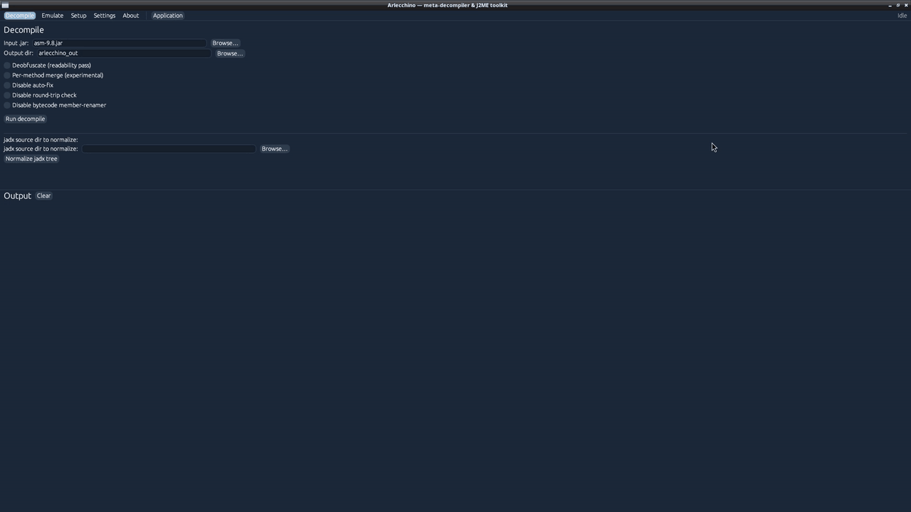
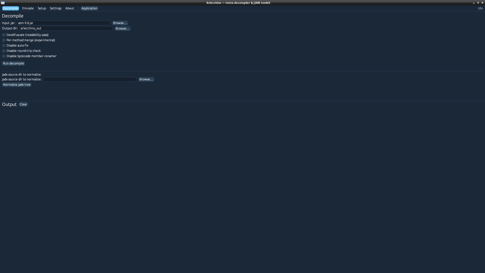
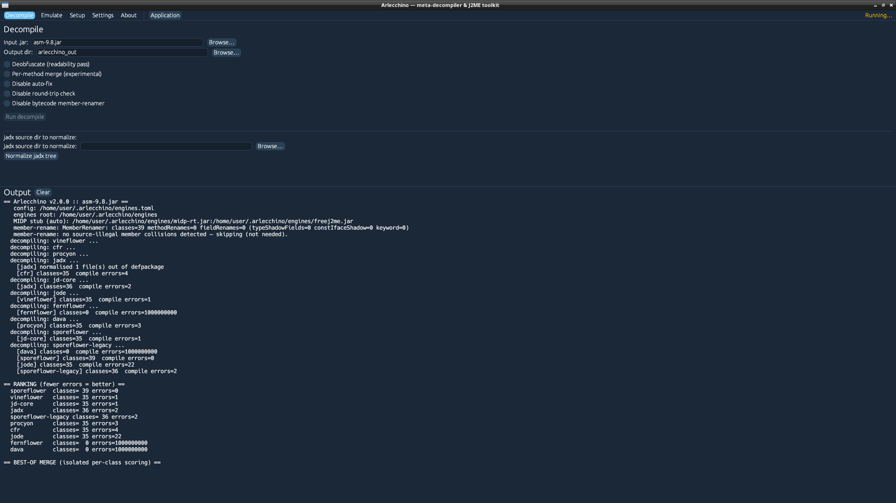
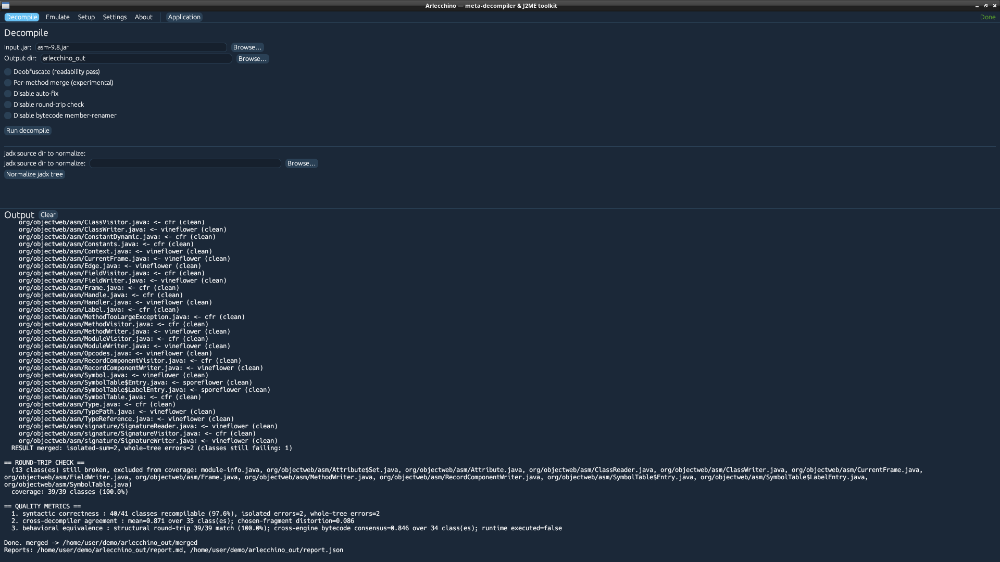

[English](README.md) | Русский | [Deutsch](README.de.md)

[](https://github.com/wehrwolfmann/arlecchino/releases/latest) [](LICENSE)

# Arlecchino — мета-декомпилятор и набор для портирования J2ME

**Мета-декомпилятор** для Java и небольшой **набор для портирования J2ME / MIDP**,
написанные на Rust. Он прогоняет один и тот же `.jar` через несколько декомпиляторов,
**приводит их вывод к единому каноническому пространству имён классов**, компилирует
каждый вариант и собирает дерево исходников *best-of* — для каждого класса (по желанию —
для каждого метода) оставляет вариант с наименьшим числом ошибок компиляции. Затем он
**автоматически исправляет** типичные артефакты декомпиляторов, **прогоняет результат
обратно** в байт-код (round-trip), чтобы измерить покрытие, умеет **деобфусцировать** код
для читаемости и **эмулировать** исходный jar во встроенной среде выполнения J2ME.



<details>
<summary>▶ Скриншоты</summary>







</details>

Его главный козырь для jar, **обфусцированных ProGuard**, — **канонический переименователь
членов, работающий с байт-кодом до декомпиляции** (ASM): перед декомпиляцией он
переписывает jar так, чтобы у каждого поля и метода было уникальное имя, *допустимое в
исходниках* Java. Именно такие имена — главный источник некомпилируемого вывода
декомпиляторов на реальных обфусцированных jar.

Над одним и тем же ядром есть две оболочки:

- **`arlecchino`** — инструмент командной строки (ниже);
- **`arlecchino-gui`** — настольная панель управления (тема steam_dark), которая
  оборачивает те же команды кнопками, выбором файлов и живым журналом, а также даёт значок
  в системном трее и действие «добавить в меню приложений».

> **Благодарность / источник идеи.** Основная идея (разнообразие декомпиляторов → выбор
> лучшего фрагмента для каждого класса/метода) взята из работы *«Java Decompiler Diversity
> and its Application to Meta-decompilation»* авторов Harrand, Soto-Valero, Monperrus,
> Baudry ([arXiv:2005.11315](https://arxiv.org/abs/2005.11315)) и их исследовательского
> прототипа *Arlecchino*. **Это независимая реализация по принципу clean-room** — их код
> не используется. Ключевое отличие: оригинал измеряет качество как **расстояние AST до
> исходного кода**, а этот инструмент — как **компилируемость** (число ошибок `javac`),
> поэтому он работает с **обфусцированными jar без исходников** — самым частым случаем на
> практике (например, при портировании старых игр J2ME/MIDP).

## Установка

### Готовый бинарник (рекомендуется)

Готовый бинарник `arlecchino` (и `arlecchino-gui`) для Linux x86-64 выложен на странице
**GitHub Releases** проекта — скачайте его, сделайте `chmod +x` и запускайте. Компилятор
не нужен. Единственное требование во время работы — **JDK 11+** в `PATH`
(`java`/`javac`/`javap`/`jar`); `git` нужен, только если вы собираете FreeJ2ME из исходников.

### Сборка из исходников

Нужен набор инструментов Rust (edition 2021), а во время работы — JDK 11+ в `PATH`.

```bash
git clone https://github.com/wehrwolfmann/arlecchino.git && cd arlecchino
cargo build --release                       # -> target/release/arlecchino  (CLI)
cargo build --release --features gui,tray   # -> target/release/arlecchino-gui  (GUI + tray)
```

## Команды

```
arlecchino setup     [--engines-root DIR] [--only vineflower,cfr,…]
                     [--freej2me-prebuilt P | --freej2me-src DIR] [--no-freej2me]
arlecchino decompile <jar> [-o OUT] [-cp DEPS] [--config C] [-j N]
                     [--midp-stub JAR | --no-midp-stub]
                     [--rename-members | --no-rename-members] [--flatten-packages]
                     [--per-method] [--deobf] [--no-autofix] [--no-roundtrip]
                     [--no-metrics]
                     [--semdiff] [--reject-semantic-drift]
arlecchino emulate   <jar> [--freej2me P] [-W 176] [-H 220] [-s 2]
arlecchino run       <jar|jad> [--midp-rt P] [--size WxH] [--rms-dir D]
                     [--no-instrument] [--trace FILE]
                     [--headless [-o OUT] [--frames N] [--period-ms N]
                                 [--boot-wait S] [--inputs SCRIPT]]
arlecchino difftest  <orig.jar> [rebuilt.jar] [--input SCRIPT] [-o OUT]
                     [--calibrate | --cross-engine [--state-tol N]]
                     [--engine freej2me|midp-rt] [--frames N] [--period-ms N]
                     [--boot-wait S] [-W 240] [-H 320]
                     [--shift-tol N] [--jaccard-margin F] [--no-baseline]
                     [--fixed-clock]
arlecchino ai-fix    [OUT] [--dry-run] [--attempts 3] [--max-classes N] [--class REL]…
                     [--provider anthropic|openai|claude-code] [--model M]
                     [--base-url URL] [--no-semantic-gate] [--no-cache] [-y]
arlecchino port-rust [OUT] [--src DIR] [--crate-dir DIR] [--crate-name N]
                     [--map FILE.map]… [--api TABLE] [--classpath CP]
                     [--jrt DIR] [--strict] [--report]
arlecchino trace-diff <ref-trace> <port-trace> [--drop-ids 3,4] [--drop-unreferenced]
arlecchino frame-diff <ref-frames> <port-frames> [--offset N] [--diff-dir DIR] [--show N]
```

`arlecchino <jar> …` — сокращение для `arlecchino decompile <jar> …` (для обратной совместимости).

### `setup` — получить движки и эмулятор

Скачивает **Vineflower, CFR, Procyon, jadx** (а также **JD-Core, Jode, Fernflower,
Dava** и обе редакции **Sporeflower**) из их выпусков на GitHub и собирает или скачивает
**FreeJ2ME** в `~/.arlecchino/engines/`. Ещё он скачивает **ASM** (`org.ow2.asm`,
BSD-3-Clause) из Maven Central в `~/.arlecchino/engines/asm/` и компилирует с ним
вспомогательную программу — переименователь членов в байт-коде.

Кроме того, он **генерирует** **clean-room-заглушку API MIDP 2.0 / CLDC 1.1** —
компилирует через `javac` публичные сигнатуры `javax.microedition.*` (только ABI, тела
пустые или бросают исключение) в `~/.arlecchino/midp-stub.jar`. Эта заглушка всегда
кладётся в classpath распознавателя у переименователя, чтобы обратные вызовы фреймворка
блокировались **точно**; если `javac` недоступен, используется офлайн-список запретов.
Каждый инструмент сохраняет свою лицензию; ничего — включая заглушку MIDP — не
скачивается и не вкладывается в этот репозиторий.

#### Воспроизводимость — закреплённые версии движков

Каждый движок **закреплён за точным тегом выпуска** — загрузка запрашивает
`releases/tags/<tag>`, никогда `releases/latest`, поэтому новый выпуск в апстриме не может
незаметно сдвинуть главную метрику.

| движок | закреплённый тег | файл | переопределение через ENV |
|---|---|---|---|
| Vineflower | `1.12.0` | `vineflower-1.12.0.jar` | `ARLECCHINO_VINEFLOWER_VERSION` |
| CFR | `0.152` | `cfr-0.152.jar` | `ARLECCHINO_CFR_VERSION` |
| Procyon | `v0.6.0` | `procyon-decompiler-0.6.0.jar` | `ARLECCHINO_PROCYON_VERSION` |
| jadx | `v1.5.5` | `jadx-1.5.5.zip` (`bin/jadx`) | `ARLECCHINO_JADX_VERSION` |
| JD-Core | `jd-cli-1.3.0-beta-1` | `jd-cli-…-dist.zip` | `ARLECCHINO_JD_CLI_VERSION` |
| Sporeflower | `v2026.11.08.40.1` | `sporeflower-<os>-<arch>.tar.gz` (нативный бинарник) | `ARLECCHINO_SPOREFLOWER_VERSION` |
| ASM | `9.7` | Maven Central | `ARLECCHINO_ASM_VERSION` |
| FreeJ2ME-plus | `1.52` | `freej2me-v1.52.zip` (`freej2me.jar` + `freej2me-lr.jar`) | `ARLECCHINO_FREEJ2ME_PLUS_VERSION` |

[Sporeflower](https://github.com/hourianto/sporeflower) — декомпилятор, созданный для J2ME
(Apache-2.0). Его текущая редакция — нативный бинарник со своими объявлениями API
CLDC/MIDP/производителей; `setup` распаковывает сборку для текущей системы в
`~/.arlecchino/engines/sporeflower/` (`.tar.gz` распаковывается системным `tar`). Его
прежняя редакция на Java — форк Vineflower, теперь живущий в ветке `legacy` апстрима, —
скачивается как `sporeflower-legacy.jar` из v2026.11.03.38.1, последнего выпуска с jar.
Обе идут в конфигурации по умолчанию после остальных движков, так что при равенстве
побеждают те. Нативная редакция переносит классы из пакета по умолчанию в пакет
`defaultpkg`, если в jar есть и именованные пакеты, и переименовывает члены, которые
считает захваченными в исходниках, в `field_N` / `method_N`; нормализатор `sporeflower`
возвращает классы на место и восстанавливает имена членов jar по его карте Tiny, так что
его классы сливаются с классами других движков.

Jode, Fernflower, Dava (Soot) и jar Sporeflower закреплены самим способом загрузки — это
одиночные прямые загрузки, версия которых входит в URL, поэтому переопределения через ENV
у них нет. Самый новый выпуск jd-cli — бета; закрепление фиксирует тот, на котором
измерялся этот порт, а не следует за тем, куда в данный момент указывает `releases/latest`.

Задайте **`GITHUB_TOKEN`** (или `GH_TOKEN`), и `setup` будет отправлять его в заголовке
`Authorization: Bearer`, снимая анонимное ограничение GitHub API в 60 запросов в час
(необязательно — анонимно тоже работает). Без сети загрузки мягко деградируют.

> Исторический главный результат **712 → 2** (ниже) изначально был измерен с **локальной**
> сборкой разработки **CFR `0.153-SNAPSHOT`**, которая шла в комплекте с jd-gui-duo. В
> апстриме выпуска `0.153` нет, поэтому `setup` закрепляет последний *выпущенный* тег CFR —
> `0.152`. Локальный `arlecchino.local.toml`, указывающий на ваши собственные jar, продолжает
> их использовать, и загрузки и закрепления `setup` на него не влияют.

### `decompile` — декомпиляция несколькими движками и слияние best-of

0. **Переименование членов в байт-коде (AUTO).** Если в jar есть коллизии членов,
   *недопустимые в исходниках* Java, а ASM и вспомогательная программа доступны, jar
   переписывается так, чтобы у каждого члена было уникальное имя, *до* декомпиляции.
   **Переименованный jar затем становится эталоном API** для всех последующих шагов.
   Включается и выключается через `--rename-members` / `--no-rename-members`.
1. Декомпилирует всеми настроенными движками (**параллельно**, `-j`).
2. **Нормализует имена**, чтобы все движки попали в одно каноническое пространство имён —
   в частности, снимается обёртка `defpackage` у jadx, чтобы jadx участвовал в слиянии.
3. Оценивает каждый класс **изолированно** относительно исходного jar как API — это
   обходит **маскировку ошибок** при пакетной компиляции `javac` и честно ранжирует движки.
4. **Слияние best-of:** для каждого класса оставляет вариант с наименьшим числом
   изолированных ошибок.
5. **Проход автоисправления:** переписывает универсальные артефакты и сохраняет
   исправление, только если оно строго уменьшает число ошибок (никогда не делает хуже).
   Шесть проходов, все в `src/autofix.rs`:
   * `fold_interface_static_init` — интерфейс констант, чей блок `static {}` присваивает
     значения его собственным пустым final-полям, превращается во встроенные
     инициализаторы, *оставаясь интерфейсом*, чтобы каждый `implements X` оставался
     корректным. При равенстве предпочитается запасному варианту с классом — ради
     единообразия всего дерева;
   * `const_interface_to_class` — запасной вариант, когда свёртка неприменима;
   * `scratch_temp_dead_array_type` — синтетическая `varNNNNN`, объявленная как массив
     одного типа, но с мёртвым присваиванием массива другого типа; мёртвое объявление
     расширяется до `Object`;
   * `resolve_unrepresentable_casts` — восстанавливает тип приведения за
     `(<unrepresentable>)` у Vineflower по соседнему декомпилятору, который его назвал;
   * `duplicate_imports` — удаление дублей;
   * `illegal_static_local` — убирает `static` у объявления локальной переменной.

   Каждый проход просматривает **маскированное представление исходника той же длины**, в
   котором строковые и символьные литералы и комментарии забиты пробелами, поэтому `{`,
   `}`, `;` или ключевое слово внутри них не может сдвинуть границу блока или вызвать
   ложную правку (`tests/autofix_mask.rs`).
6. **Проверка round-trip:** снова компилирует результат слияния в `.class` и сообщает,
   сколько исходных классов покрыто, а также грубую разницу в числе членов по сравнению
   с исходным байт-кодом.
7. **Метрики качества:** синтаксическая корректность, согласие между декомпиляторами и
   структурная проверка поведения. Этот этап перекомпилирует и перекрёстно сравнивает
   каждый класс и на большом jar занимает минуты — `--no-metrics` его пропускает; всё, что
   сообщает само слияние, к этому моменту уже выведено.
8. Записывает `merged/`, `report.md`, `report.json` и деревья каждого движка в `-o`.

`--deobf` — **частичная** и эвристическая: она помечает классы в `merged/` их вероятной
ролью в MIDP и рядом выдаёт отдельное дерево `jadx --deobf`. Имена она не восстанавливает.

`--per-method` — **экспериментальная** опция, по умолчанию выключена. На эталонной игре
автоисправления с опорой на другие движки устраняют остаток надёжнее, чем подстановка
целых методов: движки расходятся в именах локальных переменных и полей, поэтому
подстановка со строгим улучшением удаётся редко. Кроме того, в ней есть одно
сознательное, измеренное расхождение с эталонной реализацией: методы обходятся в порядке
ключей, а не в порядке исходника, и на этом jar так находятся две подстановки и
достигается изолированная сумма 3, тогда как порядок исходника находит одну и
останавливается на 4.

### `--semdiff` — семантический round-trip

Обычная проверка round-trip доказывает только **покрытие** (из каждого исходного класса
получился скомпилированный) и **грубые счётчики** (членов и методов по `javap -p`).
Автоисправление может изменить *семантику*, не затронув ни того, ни другого, — прежде
всего три исправления, которые переписывают конструкции рядом с поведением: расширение
мёртвого массива может превратить `new int[]` в `new char[]`, свёртка статического блока
заново кодирует `<clinit>`, а превращение интерфейса в класс меняет вызовы с
`invokeinterface` на `invokevirtual`.

`decompile --semdiff` дизассемблирует исходный класс (из переименованного jar — того
канонического API, которым уже пользуется весь конвейер) и перекомпилированный, метод за
методом, нормализует различия, которые законно возникают при декомпиляции и повторной
компиляции, и **помечает** методы, у которых нормализованное множество символьных ссылок
отличается по существу. Правила слияния он никогда не меняет.

**Почему множество символьных ссылок, а не поток опкодов?** Строгий дифф `javap -c`
безнадёжно шумный: `javac` заново кодирует декомпилированный исходник с другой
полярностью ветвлений (`if_icmpge` ↔ `if_icmplt; return`), другими номерами слотов
локальных переменных, другими идиомами `dup` / `x++` и выброшенными повторными загрузками —
ничто из этого не меняет поведения. Калибровка построчного диффа на заведомо хорошем
эталонном слиянии дала сотни ложных различий.

Сигнал, который стабилен **и** не даёт ложных срабатываний, использует восемь правил:

| № | правило | почему |
|---|---|---|
| N1 | сравнивать метод с методом по сигнатуре без модификаторов доступа | метод, который есть только с одной стороны, помечается |
| N2 | хранить ссылки на поля/методы как `(kind, name, descriptor)`, **отбрасывая класс-владелец** | `javac` заново привязывает член к тому супертипу, который его *объявляет* (`Field aa.H:I` против `Field j.H:I`) — тот же член, косметическое различие |
| N3 | различать **вид** вызова (`Method` против `InterfaceMethod`), владелец по-прежнему отброшен | так превращение интерфейса в класс по-прежнему ловится, а повторная привязка через интерфейс не даёт ложной пометки |
| N4 | считать `StringBuffer` и `StringBuilder` одним и тем же | декомпиляторы выдают современный `StringBuilder` для `+`, который обфусцированный байт-код строил через `StringBuffer` |
| N5 | учитывать создание примитивных массивов `newarray <type>` | ровно то, что может изменить расширение мёртвого массива |
| N6 | **исключать** `checkcast` / `instanceof` | декомпиляторы вставляют избыточные нисходящие приведения, которые оригинал проверял статически |
| N7 | **исключать** синтетический `getClass():Class` | идиома проверки на null у `javac`, которую декомпилированный исходник не воспроизводит |
| N8 | сопоставлять переименованные члены через `mapping.txt` (обратная карта `newName → oldName`) | член, переименованный переименователем, не должен выглядеть как семантическое изменение |

**Калибровка.** С N1–N8 заведомо хорошее эталонное слияние 712→2 даёт **ноль** ложных
пометок на всех **31** чисто перекомпилированных классах — включая три, которые слияние
автоисправило (мёртвый временный массив, свёрнутый интерфейс констант, восстановленное
приведение); ни одно из этих исправлений семантику не меняет. Синтетические превращения
интерфейса в класс и смена типа элементов массива *помечаются* (`tests/semdiff_javap.rs`).

Всё деградирует мягко: без `javap` модуль сообщает `available = false` и ничего не делает;
класс, который не перекомпилировался, пропускается и попадает в отчёт, но не помечается.

`decompile --reject-semantic-drift` включает `--semdiff` и превращает отчёт в решение:
каждый класс, автоисправленный слиянием, проверяется заново, и автоисправление, чей
перекомпилированный байт-код уходит от оригинала, **отбрасывается** в пользу лучшего
варианта без автоисправления — но только если откат не увеличивает число изолированных
ошибок этого класса. Поэтому оно может лишь ужесточить существующее правило «принимать
исправление, только если оно строго уменьшает число ошибок», но никогда не ослабить его.
Откаченные классы перечисляются в `report.json` в поле `semantic_drift_reverts`.

### `emulate` — запуск jar в FreeJ2ME

Тонкая обёртка над AWT-оболочкой FreeJ2ME:
`java -jar freej2me.jar <midlet.jar> W H scale`.

`setup` также устанавливает **`freej2me-lr.jar`** — libretro-оболочку (через канал)
FreeJ2ME-plus. `src/diffrun.rs` управляет ею через обычные stdin/stdout для **захвата
кадров без окна**: ни окна, ни X-сервера, ни SDL, ни нативного кода. На этом построена
система поведенческого дифф-тестирования; протокол и его подводные камни описаны в
[`docs/headless-capture-protocol.md`](docs/headless-capture-protocol.md).

**FreeJ2ME-plus распространяется под GPLv3** и всегда запускается только как отдельный
процесс — никогда не линкуется и не вкладывается в репозиторий.

### `run` — запуск мидлета в midp-rt

Запускает мидлет в **midp-rt** (LGPL-форк MicroEmulator) как **отдельный процесс** —
граница LGPL совпадает с границей процесса; ничего под LGPL здесь не линкуется.
`MIDlet-1` разбирается из манифеста/`.jad`, поэтому мидлет запускается сам, а не ждёт в
меню запуска среды выполнения. `--headless` вместо открытия окна сохраняет кадры PNG и
`index.json`.

**Откуда берётся midp-rt.** Его исходники вложены в этот репозиторий в каталоге
`midp-rt/` (git subtree, LGPL 2.1 — см. `midp-rt/COPYING-LGPL-2.1`), а собранный jar —
нет: `midp-rt/build/` игнорируется git. Соберите его один раз командой
`arlecchino setup --only midp-rt` (она сама запускает `midp-rt/build.sh`) или вручную:
`cd midp-rt && ./build.sh`. Затем jar ищется в таком порядке:

1. `--midp-rt PATH`;
2. `$ARLECCHINO_MIDP_RT`;
3. `<engines root>/midp-rt.jar` (по умолчанию `~/.arlecchino/engines`);
4. `midp-rt.jar` рядом с бинарником `arlecchino`;
5. `build/midp-rt.jar` внутри любой копии исходников форка — `$ARLECCHINO_MIDP_RT_SRC`,
   `<engines root>/midp-rt`, каталог `midp-rt/` рядом с бинарником или в любом из его
   родительских каталогов (так сборка в `target/release/` находит subtree в дереве
   репозитория) или `~/Projects/arlecchino-midp-rt`.

Если ничего не нашлось, команда выводит все проверенные пути и подсказку, как это
исправить.

`arlecchino difftest --engine midp-rt` прогоняет поведенческий дифф через midp-rt вместо
FreeJ2ME-plus — второй, независимый эталонный движок. На одной машине его отрисовка
полностью детерминирована: на эталонной игре оригинал против пересборки дал
**Jaccard 1.00 и 100 % совпадения кадр за кадром как в базовом, так и в перекрёстном
сравнении**, тогда как FreeJ2ME-plus даёт 0.86 / 97 %. На `--fixed-clock` в этом движке
этот детерминизм сейчас **не** распространяется — измеренная граница описана в
[`docs/determinism-fixed-clock.md`](docs/determinism-fixed-clock.md).

### `difftest` — поведенческий дифф (ведёт ли себя пересобранный jar так же?)

Запускает оба jar без окна с одним и тем же сценарием ввода и сравнивает **структуру
состояний экрана** — множество хешей кадров, порядок их первого появления и индексы
кадров первого появления (с допуском на сдвиг), — а также побочные эффекты RMS и
признаки падения в stderr эмулятора. *Содержимое* кадров детерминировано, *тайминг*
кадров — нет, поэтому сначала измеряется базовый уровень шума (тот же jar, запущенный
дважды), и вердикт проваливается только на сигналах сильнее этого шума.

* `--calibrate` — только базовый уровень (один jar, дважды).
* `--cross-engine` — тот же jar в FreeJ2ME-plus **и** midp-rt, сравнение мягкое
  (только структура; пиксели между движками никогда не совпадают, поэтому пиксельный
  Jaccard — справочный).
* `--fixed-clock` — сначала инструментировать jar(ы) через ASM виртуальными часами и
  ГПСЧ с фиксированным зерном, чтобы повторы совпадали кадр в кадр.

#### Формат сценария ввода

`run --inputs` и `difftest --input` принимают JSON-массив событий:

```json
[
  {"t_ms": 4500, "key": "FIRE",  "action": "tap"},
  {"t_ms": 6000, "key": "DOWN",  "action": "press"},
  {"t_ms": 6300, "key": "DOWN",  "action": "release"},
  {"t_ms": 7500, "key": "NUM5",  "action": "tap"}
]
```

* `t_ms` — миллисекунды от **первого захваченного кадра** (то есть от конца
  `--boot-wait`), а не от старта JVM. Массив не обязан быть отсортирован. Воспроизведение
  идёт по настенным часам, насколько получится: событие вводится перед первым запросом
  кадра, для которого `now >= t_ms`, поэтому точности до кадра нет — `--fixed-clock`
  вместо этого отображает `t_ms` на индекс кадра и делает детерминированной собственную
  логику мидлета.
* `key` — одно из `UP DOWN LEFT RIGHT`, `NUM0`…`NUM9`, `STAR`, `POUND`,
  `FIRE` (= `SOFT3`, средняя софт-клавиша), `SOFT_LEFT`, `SOFT_RIGHT`, `CLR` — или
  целочисленный индекс джойпада libretro-оболочки как есть.
* `action` — `press`, `release` или `tap` (нажатие, сразу за которым следует
  отпускание). По умолчанию `press`. Неизвестное имя клавиши — жёсткая ошибка, а не
  пропущенное событие.

Оба движка принимают один и тот же формат, но под `--engine midp-rt` две вещи
отличаются, потому что воспроизведение выполняет сама среда выполнения, а не джойпад
libretro:

* `FIRE` / `SELECT` / `SOFT3` отображаются на кнопку **SELECT** устройства MicroEmulator
  (средняя клавиша, игровое действие FIRE), а `CLR` — на **DELETE**;
* **целое число** в `key` означает **keyCode MIDP** (например, `53` = `NUM5`), а *не*
  индекс джойпада libretro. Поэтому сценарий с жёстко заданными индексами джойпада при
  запуске через midp-rt молча толкуется иначе — в любом сценарии для обоих движков
  используйте символьные имена.

### `ai-fix` — необязательное исправление остатка с помощью модели

**По умолчанию выключено; работает, только когда вызвано явно, и отправляет код модели.**
Работает с результатом предыдущего запуска `decompile` (`OUT`, по умолчанию
`arlecchino_out`) и трогает только те классы, которые после best-of и автоисправления всё
ещё не компилируются. Для каждого такого класса модель получает ошибки javac, вариант из
слияния, *расходящиеся участки* вариантов всех остальных движков, члены и падающие методы
исходного байт-кода, а также сигнатуры классов из jar, на которые ссылается класс.

Ответ принимается, только если выполнены все условия — иначе он отклоняется, а новые
ошибки (или ушедшие методы) отправляются обратно, до `--attempts` раз:

1. класс компилируется без ошибок, изолированно, относительно исходного jar;
2. он объявляет тот же пакет и тот же тип верхнего уровня;
3. если доступен `javap`, семантический фильтр round-trip (нормализация `--semdiff`) не
   находит методов, у которых множество ссылок на вызовы / поля / `new` ушло от исходного
   байт-кода, — поэтому класс нельзя «исправить», удалив код (`--no-semantic-gate`
   отключает эту проверку);
4. после всех подстановок во всём дереве слияния ошибок не больше, чем было; иначе
   принятые классы откатываются.

Всё складывается в `OUT/ai_fix/`: `report.md` и `summary.json` (падающие классы,
изолированные ошибки и ошибки всего дерева до → после), `journal.jsonl` (каждая попытка и
почему она принята или отклонена), `attempts/` (каждый кандидат), `before/` (заменённый
текст), `prompts/` и `cache/` ответов. `--dry-run` записывает промпты и ничего не
отправляет.

По умолчанию провайдер — Anthropic Messages API (`ANTHROPIC_API_KEY`), либо любая
OpenAI-совместимая конечная точка через `--provider openai --base-url …` — например,
локальный сервер, чтобы код не покидал машину. Перед отправкой на удалённую конечную
точку команда предупреждает и просит подтверждения (`-y` пропускает вопрос).

Если у вас установлен Claude Code и вы вошли в него, его можно использовать вместо ключа
API: `--provider claude-code` (или `provider = "claude-code"` в таблице `[ai]`, или
`ARLECCHINO_AI_PROVIDER=claude-code`). Тогда каждый запрос выполняет
`claude -p --output-format json` с промптом на stdin, со всеми отключёнными
инструментами и без MCP-серверов, в безопасном режиме (ваши собственные CLAUDE.md, хуки
и плагины не загружаются) и в пустом временном каталоге, по одному запросу за раз. При
этом расходуются лимиты использования вашей подписки Claude Code, общие с другими вашими
сеансами Claude Code. Arlecchino только запускает программу — он никогда не читает
настройки или учётные данные Claude Code. Программа — `claude` из `PATH`, либо
`ARLECCHINO_CLAUDE_BIN` / `claude_bin = "…"`; `--model` передаётся как есть (иначе
используется значение по умолчанию самого CLI), `timeout_secs` (по умолчанию 600)
ограничивает каждый вызов, а `claude_args = ["…"]` добавляет дополнительные аргументы
CLI. Кэш ответов и `--dry-run` работают так же, как с другими провайдерами. То же самое
относится к `ai-rename` и `ai-annotate`.

### `port-rust` — механический перевод на Rust (экспериментально)

Переводит дерево слияния предыдущего запуска `decompile` (`OUT/merged` или любое дерево
Java через `--src`) в крейт Cargo (по умолчанию `OUT/rust`) поверх крейта среды
выполнения `jrt` (`jrt/` в этом репозитории). Сначала `javac` атрибутирует дерево
(`assets/JavacAstDump.java`, компилируется один раз в `~/.arlecchino/helpers/port-rust`),
поэтому генератор знает тип каждого выражения и цель каждого вызова: целочисленная
семантика Java, неявное расширение типов, `switch` с проваливанием, переходы по меткам и
`try`/`catch` переводятся точно. Платформенные вызовы привязываются через таблицу
(`assets/port-rust-api.tsv`, одна строка на член MIDP/CLDC; `--api` — для другой таблицы).

Имена сохраняются, в регистре Rust: класс `GameEngine` → `game_engine::GameEngine`,
`frameCounter` → `frame_counter`, статическое `maxLives` → `MAX_LIVES`; ключевые слова Rust
становятся сырыми идентификаторами. `--map` во время генерации применяет карту имён в
формате Sporeflower `.map` (имена классов, полей, методов и параметров с пометками
`/* was … */`).

Всё, что не переведено (вызов API, которого нет в таблице, конструкция, которую
генератор пока не умеет), становится типизированным маркером `jrt::todo_ai!`, так что
крейт всё равно собирается; маркеры перечислены в `residue.json` и подсчитаны в
`report.txt` (`--report` выводит его, `--strict` завершается с кодом 1, если есть хоть
один). В крейте есть бинарник `trace`, который запускает игру без окна и пишет трассу
вызовов в формате midp-rt для построчного сравнения с исходным jar под midp-rt
(`arlecchino trace-diff`):

```sh
trace <res-dir> <trace-out> 240 320 <frames> [--ticks] [--inputs ticks.json] [--frames-dir DIR]
```

`--inputs` (или `--ticks`) запускает его так же, как `Headless --ticks N --inputs F` в
midp-rt запускает jar: тот же сценарий тиков, события доставляются в свой тик до
отрисовки его кадра, запуск останавливается после N тиков. `--frames-dir` рисует каждый
кадр программным рендерером `jrt::raster` и пишет `frame_NNNN.png`, где кадр i — экран
после тика i, как это делает `--frames-dir` у midp-rt; затем `arlecchino frame-diff`
сравнивает два каталога попиксельно (одинаковые кадры и пиксели в процентах, рамка для
каждого различающегося кадра, `--diff-dir` — для картинок с различающимися пикселями,
выделенными красным).

Рендерер следует midp-rt, а не идеализированному MIDP: `fillRect`, прямоугольники и
прямые линии, `drawImage`/`drawRegion` (все преобразования, якоря, включая арифметику
`drawRegion` у midp-rt), отсечение, сдвиг и альфа-смешивание Java2D точные; наклонные
линии и треугольники приближённые; дуги, скруглённые прямоугольники и текст не рисуются
(бинарник `trace` выводит, сколько таких вызовов он пропустил). Экран изначально чёрный;
изменяемое изображение изначально прозрачное, хранит цвета с предумноженной альфой и
рисуется без своей альфы, как под midp-rt. Метрики `Font` — таблица, измеренная под
midp-rt (шрифты AWT, поэтому они верны для той машины, на которой измерены).

## GUI

`arlecchino-gui` — небольшая настольная панель (на eframe/egui, тема steam_dark). Она
запускает те же команды `decompile` / `emulate` / `setup` как подпроцессы, выводит их
вывод в панель журнала и напрямую вызывает нормализатор дерева jadx. Кроме того, она
предлагает:

- **Добавить в меню приложений** — устанавливает freedesktop-ярлык `.desktop` и значок в
  ваши пользовательские каталоги XDG (без root).
- **Удалить…** — с окном подтверждения удаляет установленные бинарники, ярлык и значок.
- **значок в системном трее** (KDE/StatusNotifierItem) с пунктами *Открыть панель* /
  *Выход*.

### Значок приложения

Значок приложения — золотая венецианская полумаска с ромбами арлекина на лбу —
оригинальный рисунок по общественному достоянию образов *commedia dell'arte*, который
поставляется как два самодостаточных SVG, вшитых в бинарник GUI:

- `assets/icon.svg` — основной, устанавливается в
  `~/.local/share/icons/hicolor/scalable/apps/arlecchino.svg`;
- `assets/icon-small.svg` — тот же рисунок без гравировки, устанавливается в
  `hicolor/16x16` и `hicolor/24x24`, потому что ниже ~32 px целый орнамент умещается в
  один пиксель и лишь замутняет силуэт.

Чтобы использовать другой значок, замените эти файлы и пересоберите программу или
замените установленные копии на месте. Держите их самодостаточными (без растровых
данных, шрифтов и внешних ссылок) — ярлык записывает файл как есть.

## Язык (EN / RU / DE)

Весь текст для пользователя (GUI, а также обрамление и ошибки CLI) доступен на
**английском**, **русском** и **немецком**. Порядок выбора:

1. `ARLECCHINO_LANG=en|ru|de` — переопределение (так же GUI передаёт свой язык
   запускаемым подпроцессам CLI);
2. сохранённая настройка в `~/.config/arlecchino/settings.toml`
   (`language = "system" | "en" | "ru" | "de"`), которую записывает меню GUI
   **Настройки -> Язык**; значение по умолчанию, `system`, сохраняет описанное ниже
   поведение по локали;
3. системная локаль (`LC_ALL` → `LC_MESSAGES` → `LANG`; `ru*` → русский, `de*` →
   немецкий, всё остальное → английский).

Переключение языка в GUI действует сразу — без перезапуска — и сохраняется до
следующего запуска. Технический вывод (содержимое report.json / report.md, журналы
прогресса и слияния, пути к файлам, имена флагов) остаётся стабильным и не переводится.

## Честный подсчёт ошибок

`javac` работает **по принципу «всё или ничего» на один вызов**: одна ранняя структурная
ошибка прерывает атрибуцию *остальных* файлов, **маскируя** их настоящие ошибки. Вместо
этого инструмент **компилирует каждый класс изолированно** относительно исходного jar
(который даёт канонический API всех соседних классов) и суммирует ошибки по классам —
честная метрика, которую нельзя замаскировать. Ещё он автоматически добавляет в classpath
**заглушку MIDP**, чтобы разрешался `javax.microedition.*`: сначала `midp-rt.jar`, если он
установлен (его сигнатуры соответствуют спецификации), затем jar FreeJ2ME (API
производителей и всё, чего нет в midp-rt). FreeJ2ME сам по себе теряет некоторые
проверяемые исключения — например, `Player.stop()` без `throws MediaException`, — из-за
чего верный `catch` становится ошибкой компиляции. Переопределяется через `-cp`,
`--midp-stub` (используется в одиночку) или `--no-midp-stub`.

Поэтому наивная компиляция всего дерева сильно обфусцированного jar может выдать
обманчиво маленькое число. Ранний прототип этого инструмента сообщал на эталонной игре
«1 ошибку» — это был артефакт маскировки `javac`, при котором одна ошибка в интерфейсе
скрывала примерно семьсот настоящих. Цифры ниже — честные, немаскированные изолированные
счётчики, и по ним слияние действительно обходит каждый отдельный движок.

## Пример — измерено на обфусцированном jar игры J2ME

⚠️ **Условия.** Эти числа измерены в июне 2026 года на `Allods_1_2_240x320.jar` с
**локальной конфигурацией из четырёх движков**, в которой CFR был невыпущенной сборкой
разработки `0.153-SNAPSHOT` (см. примечание в разделе `setup`). Это главный результат
проекта, и он приводится здесь именно как таковой. Это **не** действующий фильтр
регрессий — им служит `regress/expected.txt`, измеренный позже с шестью закреплёнными
движками и перепроверенный jar за jar против эталонной реализации, и он даёт для того же
jar другие (столь же верные) цифры. Не считайте, что одно противоречит другому; см.
[`docs/history-and-decisions.md`](docs/history-and-decisions.md).

По движкам, **переименователь членов ВЫКЛЮЧЕН**, изолированные ошибки (меньше — лучше):

| движок | классов | изолированных ошибок |
|---|---|---|
| cfr | 30 | 978 |
| vineflower | 30 | 1053 |
| jadx | 32 | 1066 |
| procyon | 30 | 1183 |

С **включённым переименователем членов** (по умолчанию AUTO) исходный счёт каждого движка
обваливается — procyon 1183 → 1, cfr 978 → 16, vineflower 1053 → 11, jadx 1066 → 7.

* **Слияние best-of, переименователь ВЫКЛЮЧЕН** (`--no-rename-members`): **712** —
  примерно на 27 % меньше, чем у лучшего отдельного движка, при 100 % покрытии классов
  в round-trip. Основная часть этих 712 вызвана членами ProGuard, перегруженными по
  дескриптору.
* **Слияние best-of, переименователь ВКЛЮЧЁН** (по умолчанию): **2**, при **100 %
  (32/32)** покрытии классов в round-trip, и всё дерево из 31 класса пакета по умолчанию
  компилируется вместе.
* **С `--flatten-packages`: 0** — см. ниже.

Одна находка, которую стоит назвать: поле, названное так же, как тип из jar, на который
оно ссылается, — например, `class j { int o; }`, использующий `o.c`, где `o` — ещё и
тип, — затеняет тип в исходнике и само по себе даёт **57 ложных ошибок
`int cannot be dereferenced`**.

## Переименователь членов в байт-коде

ProGuard использует **одно и то же имя члена с разными дескрипторами** — это допустимо в
байт-коде JVM (члены различаются по имени **и** дескриптору), но **недопустимо в
исходниках Java**, поэтому вывод декомпилятора не компилируется. Текстовое
переименование на уровне исходников это не исправит — место использования не знает, к
какому из перегруженных объявлений оно привязано. Поэтому переименователь работает **в
байт-коде, до декомпиляции**: небольшая вспомогательная программа на ASM
(`assets/MemberRenamer.java`, компилируется `setup`) загружает каждый класс, находит
коллизии, недопустимые в исходниках (повторяющиеся имена полей; перегрузки методов,
различающиеся только типом возврата), объединяет группы переопределений, чтобы сохранить
виртуальную диспетчеризацию, **блокирует** члены, связанные внешним контрактом (MIDP/JDK),
и переписывает все ссылки (включая общие записи NameAndType в пуле констант).

**Схема новых имён.** Внутри группы коллизий первое вхождение сохраняет имя; каждый
другой участник коллизии становится `<orig>_<tag>`, где `<tag>` — первые 8 шестнадцатеричных
цифр хеша FNV-1a-64 от **полного дескриптора** члена (числовая добавка `_2`, `_3`, …
идёт, только если и это имя занято). Переименовываются только реальные участники
коллизий. Рядом с переименованным jar записывается `mapping.txt`
(`owner.oldName desc -> newName`) — именно с ним сверяется `--semdiff`.

**Блокировка.** Член, связанный внешним контрактом, — обратный вызов MIDP или JDK,
который среда выполнения вызывает по имени, — никогда не должен переименовываться. Если
заблокированный метод конфликтует с другим, переименовывается **другой** участник
коллизии. Распознавание выполняется точно, через рефлексию по сгенерированной
clean-room-заглушке MIDP; жёстко заданный список запретов с известными обратными
вызовами хранится **только** как офлайн-запасной вариант, потому что сплошная блокировка
помешала бы исправлять настоящие коллизии по типу возврата.

**Измерено на эталонной игре:** 32 класса → **355 переименований полей и 50
переименований методов** (291 перегрузка по дескриптору, 56 затенений типов, 8 затенений
через интерфейс констант). Переименованный jar проходит верификацию — все 32 класса
загружаются через верификатор JVM с 0 ошибок, — в нём **ноль** оставшихся коллизий
повторяющихся полей или типов возврата, и **ни один обратный вызов MIDP не был
переименован** (проверено: `GameMIDlet.startApp/pauseApp/destroyApp` и
`run/showNotify/hideNotify/keyPressed/keyReleased` класса холста не тронуты).

### Переименование полей, затеняющих имя типа

`X.c`, где `X` — одновременно поле текущего класса и тип из jar, разбирается как
`(this.X).c` — поле затеняет тип, и компилятор затем жалуется, что примитив нельзя
разыменовать. Переименователь переименовывает поле `C.X`, только если в jar есть тип с
простым именем `X` **и** `C` действительно ссылается на внутреннее имя этого типа в своём
байт-коде, так что случайное совпадение имён не трогается. На эталонной игре одно это
правило убирает все **57** ошибок `int cannot be dereferenced` (41 в классе `j`, 15 в `e`,
1 в `i`).

### Переименование полей, затеняющих унаследованную константу интерфейса

Поле экземпляра, затеняющее константу, унаследованную от реализованного интерфейса
констант, делает каждое неквалифицированное использование неоднозначным. Переименователь
переименовывает конфликтующую **константу** в интерфейсе — член только для чтения, не
влияющий на диспетчеризацию, — а не поле экземпляра. На эталонной игре это убирает
оставшиеся ошибки неоднозначных ссылок.

### `--flatten-packages` (по запросу)

Класс в именованном пакете не может обратиться к типу из пакета **по умолчанию
(безымянного)** — это правило языка Java (**JLS §6.5 / §7.4.3**), а не пробел
декомпилятора, поэтому в jar, где смешано и то и другое, остаётся неустранимый остаток
ошибок `cannot find symbol`, который не уберёт никакой переименователь. На эталонной игре
этот остаток — ровно честные **2**: обе ошибки в `Container/GameMIDlet`, и обе — одна и та
же проблема: класс живёт в пакете `Container`, но ссылается на типы из пакета по
умолчанию.
`--flatten-packages` принимает то же решение, что и при ручном портировании: тот же проход
ASM переотображает ещё и **типы**, перенося каждый класс из jar в пакет по умолчанию. Все
ссылки на типы согласованно переписываются (extends/implements, дескрипторы,
`NEW`/`CHECKCAST`/`INSTANCEOF`, владельцы полей и методов, константы классов `LDC`,
сигнатуры), **путь записи каждого класса в jar следует за его новым именем**, и вместе с
ним переписывается атрибут класса-точки входа в манифесте (`MIDlet-1:`, `Main-Class:`).
При совпадении простых имён первое сохраняется, а остальные получают стабильный суффикс
`_<8hex>`.

Оговорка: проход переписывает *ссылки* на типы, но не строковые **константы** — в jar,
который находит классы по **литералу** с именем пакета вроде `Class.forName("pkg.Foo")`,
эти литералы пришлось бы обновить вручную. Перед тем как доверять флагу на эталонной
игре, это было проверено: в ней **нет** таких литералов `forName` (её единственные
вхождения `Container/GameMIDlet` — дескрипторы типов), и ресурсы она загружает по
**пути** (`getResourceAsStream("/res/…")`), а не по имени класса, — так что для этого jar
уплощение — полное исправление, безопасное для round-trip. Прежде чем полагаться на него
в другом месте, проверьте те же две вещи.

**Результат на эталонной игре:** `--flatten-packages` переносит `Container.GameMIDlet` в
пакет по умолчанию, и его 2 межпакетные ошибки исчезают, убирая весь неустранимый
остаток; покрытие round-trip остаётся 100 %. Без флага переименованный jar **бит в бит**
такой же, как был, так что путь по умолчанию не затронут.

### Что эти числа доказывают и чего не доказывают

Изолированный счётчик — честная, немаскируемая метрика по классам: каждый класс
компилируется отдельно относительно **переименованного** jar плюс заглушки MIDP как
своего API. На эталонной игре он был воспроизведён независимым повторным изолированным
измерением всех 32 классов (31 чистый, `GameMIDlet` = 2), а 31 класс пакета по умолчанию
также компилируется **вместе** как дерево (ошибок во всём дереве = 2, то есть только
`GameMIDlet`).

Покрытие round-trip (100 %, 32/32) — **структурный дымовой тест**: оно доказывает, что
каждый класс компилируется относительно API переименованного jar, причём классы, которые
не удалось перекомпилировать, подставляются из исходного байт-кода, чтобы их зависимые
классы всё равно разрешались. Это **не** поведенческая эквивалентность. Поведение —
отдельный вопрос, на который отвечает `difftest`, — и ответ получен: на эталонной игре
пересобранный jar в точности воспроизводит состояния экрана оригинала. См.
[`docs/behavioural-verification.md`](docs/behavioural-verification.md).

## Фильтр регрессий

`regress/expected.txt` хранит числа слияния по каждому jar эталонного корпуса, а
`regress/run.sh` измеряет их заново:

```sh
cargo build --release
ARLECCHINO_CORPUS=/path/to/corpus regress/run.sh   # or: regress/run.sh /path/to/corpus
```

Папка корпуса берётся из аргумента, а без него — из `ARLECCHINO_CORPUS`; если нет ни
того, ни другого, скрипт останавливается с подсказкой.

Сравниваются оба числа строки `RESULT merged:` (запуск идёт с `--no-metrics`, которые в
фильтр не входят), и несовпадение даёт ненулевой код выхода. Измерение использует
`regress/engines.6.toml` — поставляемый набор движков по умолчанию без двух записей
`kind = "class"`, — потому что эти числа перепроверены jar за jar против редакции на
Python, которая эти два движка запускать не умеет. Держите этот файл в согласии с
`assets/engines.default.toml`, когда меняется вызов какого-либо движка.

## Тесты

`cargo test`. Набор тестов закрепляет поведение, а не добавляет новое; ему не нужно
ничего сверх того, что уже устанавливает `arlecchino setup`, а каждый тест, у которого
нет нужных условий, выводит `SKIP: <reason>` и проходит успешно, а не падает. Что
покрывает каждый файл и что где пропускается — в [`tests/README.md`](tests/README.md).

## Документация

В [`docs/`](docs/README.md) лежат исследовательские отчёты, измерения и записи решений,
стоящие за утверждениями выше: протокол захвата, который пришлось восстанавливать
обратной разработкой, граница детерминизма и история её регрессий, откуда взялась
вложенная среда выполнения MIDP и под какими лицензиями, числа поведенческой проверки, а
также альтернативы, которые были рассмотрены и отвергнуты. Ничего из этого нельзя
вывести из исходного кода.

## Настройка

Конфигурация движков — TOML/JSON. Порядок выбора: `--config PATH` →
`./arlecchino.toml` → `~/.arlecchino/engines.toml` → встроенная конфигурация по умолчанию.
У каждого `[[engine]]` есть `name`, `type` (`names`/`renamed`), `kind` (`jar`/`tool`),
`path`, `args` (с `{jar}`/`{out}`), необязательные `sources_subdir` и `normalize`
(`none`/`jadx`).

## Участие в разработке

Вклад принимается на условиях [Лицензионного соглашения участника](CLA.md).
Как предложить изменение — см. [CONTRIBUTING.md](CONTRIBUTING.md).

## Лицензия

**Apache-2.0** — см. [LICENSE](LICENSE) и [NOTICE](NOTICE). Независимая работа по
принципу clean-room; сторонние декомпиляторы, FreeJ2ME и ASM (BSD-3-Clause, используется
переименователем членов) вызываются / скачиваются как отдельные процессы / артефакты под
их собственными лицензиями и в комплект не входят.
